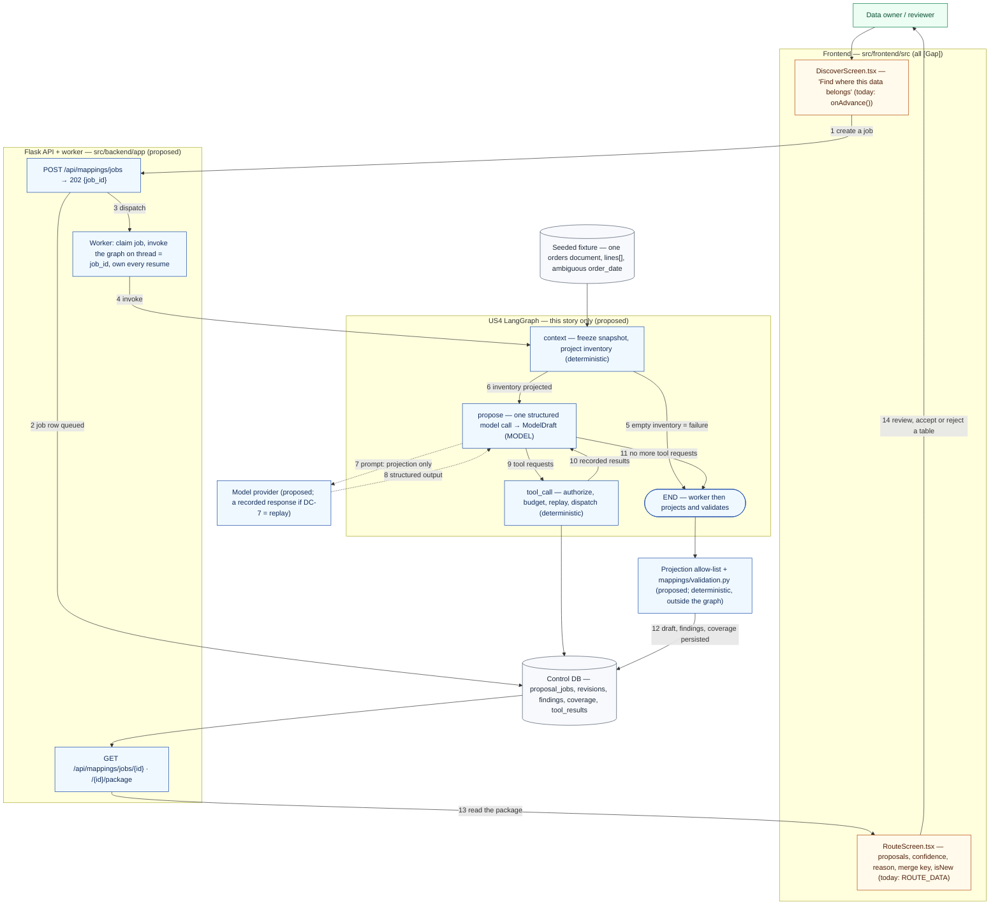

# US4 — Automatically map / route data

**Status:** Proposed implementation plan — planning document only. Nothing in this file is implemented.
**Acceptance-criteria source:** `src/frontend/src/imports/GenLedge_Connector_MVP_User_Stories.pdf` (US1–US7), quoted not paraphrased.
**Scope of this document:** the **US4-only** LangGraph integration — its graph, its state, its contracts, its integration points, its tasks and its tests. It is written to be usable on its own.
**Shared registers (linked, not restated):** [`../LANGGRAPH_HARNESS_PLAN.md`](../LANGGRAPH_HARNESS_PLAN.md) §5.3 (contract conventions), §5.6 (reducers), §7 (prompt construction), §8 (model adapter, tools), §9 (failure taxonomy, statuses), §11 (test layers), §12.3 (phase gates), §16.5 (the cross-story task register, authoritative for task id, priority, owner and evidence), §18 (the end-to-end demonstration). **That document is not modified by this plan.**

*PDF story:* "As a data owner, I want GenLedge to automatically determine where my source data belongs in the warehouse in order to reduce the amount of manual data engineering required."

**This story's design is deliberately independent.** There is no master graph combining US4, US5 and US6; US4's graph is not invoked by, and does not invoke, another story's graph. §10 records the few cross-story dependencies the acceptance criteria themselves create.

---

## 1. Acceptance criteria, current status and remaining work

AC identifiers are this plan's; they exist so one criterion can be referenced unambiguously from the task tables and from the master plan.

| AC | Acceptance criterion (source wording) | Current status (repository evidence) | Remaining work in the D2 slice | Tasks | Blocking decision |
| --- | --- | --- | --- | --- | --- |
| **US4-AC1** | Allow the user to select "Find where this data belongs" | **Partial.** `DiscoverScreen.tsx` renders a `Run AI Routing` button whose handler is `onAdvance()` — a screen change, no request. The AC's literal label differs from the UI's | Make the trigger create a job (`POST …/jobs` → `202 {job_id}`) and drive a pending state from the job's status; settle the label | `D2-FE-1` | `DC-4` (label) |
| **US4-AC2** | Provide the AI with discovered source fields and the existing warehouse table catalogue | **[Gap].** No model call exists anywhere in `src/` | Build the graph's `context` node, the projection and the first prompt; seed the fixture that supplies them | `D2-LG-1`, `D2-LG-2`, `D2-PF-2` | `Q1` (catalogue), `Q2` (provider) |
| **US4-AC3** | Allow AI to reuse an existing warehouse table or propose a new table | **Partial (affordance only).** `RouteScreen.tsx`'s `ROUTE_DATA` carries `isNew: false` for `fact_orders`/`dim_customers` and `isNew: true` for `fact_order_lines`; no contract field or check backs it | Emit per-table `isNew` from `catalog_ref`; the **reuse** path additionally needs a second seeded catalogue | `D2-LG-3` (cold start **P0**; reuse path **P1**) | `Q1` |
| **US4-AC4** | Allow one source collection to route into multiple warehouse tables | **Partial.** The fixture routes one collection (`orders`) into three tables, so the surface exists; no contract or check enforces it | Nothing new to model — enforce it in validation (one `Table` per target, several targets per source collection) | `D2-DM-1` | — |
| **US4-AC5** | Allow AI to propose target columns and a merge key | **Partial.** `mergeKey` exists per fixture table; nothing validates that it is non-empty, unique, or a real column | Require `Table.key` in the contract and validate presence, uniqueness and membership | `D2-LG-3`, `D2-DM-1` | — |
| **US4-AC6** | Use field names, types, descriptions, sample values, and repeating structure when deciding where data belongs | **[Gap], with a contract hole.** The UI's discovered-field shape is `{path, type, nullable, repeating, samples[], status, ambiguous?}` and the projection allow-list is field paths, types, repeating status and ≤3 samples. **Neither carries a field *description***, which this criterion names as an input | Seed and project path/type/repeating/≤3 samples through the real path; decide whether a description exists at all | `D2-PF-2`, `D2-LG-2` | `DC-1` |
| **US4-AC7** | Return confidence and a human-readable reason for the routing decision | **Partial (fixtures only).** `RouteScreen.tsx` shows `92%`/`87%`/`78%` and a `reason` string; no contract requires either to be present or non-empty | Make `confidence` and `rationale` contract-required, and render the live values | `D2-LG-1`, `D2-DM-1` | — |
| **US4-AC8** | Validate all AI-generated table and field references before applying them | **[Gap].** `app/mappings/validation.py` is planned and does not exist | Build the deterministic validator as pure functions over the contracts | `D2-DM-1` | Contract freeze (master §12.3 Phase 1) |
| **US4-AC9** | Report invalid references and unrouted fields with reasons | **[Gap].** An `unmapped` count comes from a fixture; no reason vocabulary exists anywhere in the repository | Emit findings with codes, compute coverage, render both on the routing screen | `D2-DM-1`, `D2-FE-1` | `DC-2` (reason-code vocabulary) |
| **US4-AC10** | Do not automatically alter a populated warehouse table; hold new columns for human approval | **[Gap].** No target warehouse exists to alter, so the rule has no enforcement point | Make the executor's write path create-or-load only, never `ALTER` a populated target; **not** demonstrable as a before/after comparison in D2 because the demo target is created fresh | `D2-DM-3` | — |
| **US4-AC11** | Preserve successful tables/pipelines even when one mapping operation fails | **[Gap].** Per-table accept/reject exists in the fixture only | Define per-table partial success in validation and record the reviewer's per-table decision through the edit endpoint | `D2-DM-1`, `D2-LG-1` | `DC-3` |
| **US4 boundary** | "The model receives field paths, inferred types, repeating status, and limited sample values plus the target-table catalogue. Whole rows, database IDs, connection strings, client name, and existing mappings are not sent as model input." | **[Gap] as a guarantee.** The allow-list and the sentinel tests are specified; no code enforces either — and `RouteScreen.tsx`'s own alert currently asserts this as if it were already true | Implement the projection allow-list and the sentinel test so the boundary is executable code, not a UI claim | `D2-LG-2`, `D2-TS-1` | `Q2` (provider data handling) |

**Status vocabulary used above:** **[Current]** exists in the tree · **[Gap]** described in a document but not implemented · **Partial** a UI affordance or fixture exists without the contract behind it. Every `[Gap]` and `Partial` row must be built or explicitly reported as unmet; none may be reported as complete because a fixture renders something similar.

**Remaining work by layer, in one view** — the same tasks, grouped the way the work actually lands: frontend (`D2-FE-1`, `D2-FE-3`); API (`D2-BA-1`, `D2-BA-3`); backend-domain (`D2-DM-1`); LangGraph/model (`D2-LG-1`, `D2-LG-2`, `D2-LG-3`); persistence (`D2-PF-2`, `D2-PF-1`); deployment (`D2-D-1`).

**Rejected as a solution:** a UI-only change. Four of the eleven criteria (AC2, AC6, AC8, AC9) and the boundary criterion name data the screen does not have, so no amount of frontend work closes them.

---

## 2. Current implementation status, in detail

| Surface | Evidence | What it actually does |
| --- | --- | --- |
| `src/frontend/src/features/discovery/DiscoverScreen.tsx` | `Run AI Routing` button, handler `onAdvance()` | Changes the screen. No fetch, no job, no routing. |
| `DiscoverScreen.tsx` field tree | local `FIELD_DATA` (line 9) keyed `'orders' \| 'order_lines' \| 'customers'`, shape `{path, type, nullable, repeating, samples[], status, ambiguous?}` | A module constant. It is the only description of the discovered-field shape in the repository, which is why `DC-1` is about *this* shape. |
| `src/frontend/src/features/mappings/RouteScreen.tsx` | module constant `ROUTE_DATA` (line 6), 3 proposals (`fact_orders` 92 %, `fact_order_lines` 87 % `isNew`, `dim_customers` 78 %), each `{table, isNew, confidence, mergeKey, reason, fields[]}` | Renders fixtures. `decisions` state records accept/reject locally. The page's trust-boundary alert states the US4 boundary as fact. |
| `src/frontend/src/features/auth/client.ts` | the only HTTP client in the tree | Base URL, credentials and a timeout — but nothing in the routing path calls it. |
| `src/backend/app/mappings/` | `__init__.py` docstring only | No service, no validation, no routes. |
| `src/backend/app/sources/connectors/__init__.py` | docstring only | No connector, so the "discovered source fields" of AC2 have no live producer; the D2 slice substitutes the seeded fixture (`D2-PF-2`). |
| `src/backend/requirements.txt` | `Flask>=3.1,<4` | No `langgraph`, no `pydantic`, no provider SDK is declared. |
| `src/backend/tests/` | `test_app.py`, `test_auth.py` | 6 test functions / 18 collected items, all auth/app. Nothing touches routing. |
| Repository-wide search for `langgraph\|langchain\|anthropic\|openai\|llm\|prompt` under `src/` | no matches | No model call, prompt file, or adapter exists. |

Nothing in US4 is implemented. The three `RouteScreen.tsx` proposals are the *shape* the product expects, not evidence of a routing capability.

---

## 3. Does US4 need LangGraph?

Justified operation by operation. This is the evaluation the graph has to survive; a row that says "no" is a row that must **not** become a node.

| Operation | What it really is | Needs graph mechanics? |
| --- | --- | --- |
| Freeze the demo snapshot and project the inventory (`context`) | A deterministic read plus field profiling over the seeded fixture | **No.** It is a pure function of the source and the projection allow-list. It runs first, so it is a node only because something must run first. |
| Propose the target tables and columns (`propose`) | Model-assisted reasoning over the projected inventory, returned as a typed `ModelDraft` | **Partly.** One structured generation needs a call, not a graph — but its *output must survive a tool round-trip*, which is state that has to live somewhere. |
| Fetch further field evidence (`tool_call`) | Deterministic authorization, budget check, replay, dispatch, redaction, persistence | **Yes — this is the only part of US4 that genuinely earns LangGraph.** It is a loop with a model inside it, the loop bound has to be counted, and a replayed call must be idempotent. Expressing that as a `while` in a service is possible; expressing it as an explicit bounded loop with recorded state is what a graph buys. |
| Deterministic validation and business rules (`D2-DM-1`) | Pure functions over the contracts | **No — and deliberately outside the graph.** Validation must run on every path, including paths the graph never sees (an edit, an approval, a re-run). Putting it in a node makes it conditional on graph entry. |
| Projection of `ModelDraft` → `MappingDraft` | Pure transformation with an allow-list | **No.** Same argument: it is a service call made by the worker after the graph returns. |
| Persistence and status transitions | Rows in `proposal_jobs`, revisions, findings, coverage | **No.** The graph writes state; the application writes rows. Keeping persistence out of the graph is what makes the reviewer's screen readable without a checkpointer. |
| Human review and approval | US5's story | **Not in US4.** US4's job ends at "reviewable package published". |

**Verdict: LangGraph is justified in US4 for exactly one reason — the model↔tool loop — and this plan does not pretend otherwise.** The graph is three nodes: `context` → `propose` ⇄ `tool_call`, ending when the model stops requesting tools. Everything else US4's criteria need is deterministic service code called by the worker around the graph.

**And a second, sharper point for D2.** The seeded fixture is small by construction (one orders document, ≤3 samples per field). A model can be handed the entire projected inventory in one prompt, so the loop need never be entered. If D2 cuts the loop, **US4 is a single structured model call** and the honest description is "a guarded generation step, not an agentic workflow". Two consequences the plan accepts:

- The harness gate at `doc/agent-harness-architecture.md` line 238 requires a job to start, **complete a tool call**, persist a result, resume from a checkpoint and end with a schema-valid output. Satisfying it in D2 therefore means exercising the loop at least once (`read_field_values` on `orders.lines[]` is the natural single call), and the demo must say the loop was exercised **once**, not that it is load-bearing.
- If the whole graph were cut, the same node functions run correctly through a plain runner. That is a legitimate D2 simplification **only if labelled**, because it turns the demonstration into a product demo rather than a harness demo.

**Where a plain deterministic workflow is better, stated plainly:** for a small, fully-projected inventory with no tool needs, and for every step after `propose`. Adding a node for validation, projection or persistence would put deterministic code behind a conditional router — the exact failure mode master §3.5's anti-duplication rules exist to prevent.

---

## 4. The US4 graph

### 4.1 US4 workflow

Proposed components are blue/dashed; shapes marked **[Gap]** are current screens that do not yet do this.



Two properties this diagram is meant to make visible: the **only** model input is the projection (edge 7), and the reviewer reads **persisted rows** (edge 13), never graph state.

### 4.2 Nodes

| Node | What it does | Writes | Load-bearing rule |
| --- | --- | --- | --- |
| `context` | Resolves `source_snapshot_ids` from the seeded fixture, loads the inventory, applies the projection allow-list, loads `catalog_ref` if one was supplied | `source_snapshot_ids`, `inventory_ref`, `catalog`, `status`, `updated_at` | **No model.** An empty inventory is a **failure**, not an empty proposal. Snapshotting is idempotent per `(source_id, fingerprint)`. |
| `propose` | One model call whose typed output is a `ModelDraft`; may request tools instead of answering; assigns nothing the harness must own | `model_draft`, `pending_tool_calls`, `model_calls_used`, `tokens_used`, `messages`, `status`, `failure`, `updated_at` | One model call per invocation. Tools are **requested here, never executed here**. Neither a draft nor a tool request ⇒ one repair attempt, then `invalid_model_output`. |
| `tool_call` | Turns `pending_tool_calls` into authorized, budgeted, recorded results — or typed errors the model can reason about | `tool_results`, `tool_calls_used`, `pending_tool_calls=[]`, `messages`, `updated_at` | Per call: validate arguments → check the job's scope covers the resource → check the budget → **replay if this `tool_call_id` already ran** → dispatch → validate → redact → persist the payload → append a compact ref. Sequential in D2. |

### 4.3 Edges, routing and loop bound

| Edge | When |
| --- | --- |
| `START → context` | Always. |
| `context → END` | Inventory empty or unsupported → a **failed** job with a typed reason. No partial proposal. |
| `context → propose` | Inventory projected. |
| `propose → tool_call` | The model requested tools and `tool_calls_used < max_tool_calls`. |
| `propose → END` | The model returned a schema-valid `ModelDraft`, or a terminal failure. |
| `tool_call → propose` | Always — the loop returns to the model with results. |

The loop is bounded by `max_tool_calls` and `max_model_calls` from the frozen `AgentBudgets`; the budget predicate is checked **before** the dispatch, and exhaustion routes to `END` with a recorded failure rather than raising. `recursion_limit` is derived (master §6.5) so the semantic budgets always fire first — US4 must never observe a `GraphRecursionError` as its stopping condition.

### 4.4 Minimum graph state

**Provisional, and US4-only.** This is the smallest state the three nodes above need. It is *not* evidence that US5 or US6 will use one shared state schema; see §10.

```python
class RoutingJobState(TypedDict):
    job_id: str
    source_snapshot_ids: list[str]     # frozen at `context`; an executor reads these later (master §5.3)
    inventory_ref: str                 # a persisted reference, never the whole inventory inlined
    catalog_ref: str | None            # `None` = cold start (master §2.4a)
    active_step: Literal["propose"]    # the only step that can request tools in this story
    pending_tool_calls: list[ToolCallRequest]
    tool_results: Annotated[list[ToolResultRef], operator.add]   # refs, never payloads
    model_draft: ModelDraft | None     # the only model-produced state field
    revision_count: int
    model_calls_used: int
    tool_calls_used: int
    tokens_used: int
    budgets: AgentBudgets              # frozen at job creation
    failure: FailureInfo | None
    updated_at: str
```

Conventions (master §5.6, not repeated here): each node's `Writes` list in §4.2 is enforced by a state guard; `ModelDraft.revision` is **overwritten** by the harness from `revision_count` after validation; `tool_results` holds refs, so a payload never re-enters the prompt unless the projection puts it there. There is no `mapping_draft` in this state: the projection that produces one runs after the graph ends (§3).

### 4.5 Not in this graph, on purpose

`revise`, `semantic_review`, `await_human`, `approved`, and any human-interaction point. US4 has **no `interrupt()`**: a reviewer never pauses a routing job mid-flight, because the proposal is the artifact they review. The checkpointer US4 needs is for **crash recovery inside the run**, not for a human pause — which is why the D2 simplification in §6.4 has to be labelled rather than glossed.

---

## 5. Contracts and data flow

### 5.1 What the model receives, and what it must never receive

The projection is the only path from the process to a prompt.

| Variable | Origin | Bounded how |
| --- | --- | --- |
| `{{job_ref}}` | `job_id[:8]` | Opaque prefix; the organization id is **never** rendered |
| `{{inventory}}` | the seeded inventory record, projected | one line per resource/field; page-capped; `… and N more` marker |
| `{{catalog}}` | `catalog_ref`, or the literal `No existing warehouse catalogue. Propose a new model.` | table/column names and types only |
| `{{tool_results}}` | recorded tool results from the current step | JSON, redacted, delimited as untrusted data, ≤3 sample values per field |
| `{{budgets}}` | frozen `AgentBudgets` | one line per budget |
| `{{output_schema}}` | `ModelDraft.model_json_schema()` | schema only |

Must never appear: whole rows, database IDs, connection strings, credentials, the client name, pre-existing mappings, the organization id, or reviewer identity. Enforcement is a projection allow-list plus the sentinel tests in §8 — **not** a prompt instruction. `RouteScreen.tsx`'s existing alert states this boundary as fact; until `D2-LG-2` lands, it is a claim about code that does not exist.

### 5.2 The proposal contract (boundary models)

Defined in `app/agent/contracts.py` **[Proposed]**. These are the fields US4's criteria refer to; the full contract set, the shared conventions and the validation boundaries are in master §5.

```python
Identifier = Annotated[str, StringConstraints(pattern=r"^[A-Za-z_][A-Za-z0-9_.\[\]-]*$")]

class Disposition(str, Enum):   REPRESENTED | RAW_ONLY | EXCLUDED | SENSITIVE | UNRESOLVED
class SourceType(str, Enum):    TEXT | NUMBER | BOOLEAN | TIMESTAMP | DATE | JSON
class Severity(str, Enum):      BLOCKER | WARNING | INFO

class EvidenceRef:              resource_id: str; field_path: str | None; profile_ref: str | None
class Attribute:                id: Identifier; type: SourceType; nullable: bool
                                evidence: list[EvidenceRef]          # min_length=1 — no uncited attribute
                                confidence: float                    # 0.0 … 1.0
                                ambiguity: str | None                # e.g. "date_format_ambiguous"
class Relationship:             from_ref: Identifier  (alias "from"); to_ref: Identifier
                                cardinality: one_to_one | one_to_many | many_to_one | many_to_many
                                evidence: list[EvidenceRef]          # min_length=1
class Table:                    id, name: Identifier
                                kind: entity | event | reference
                                grain: str (1–300)                   # min_length=1 — an explicit grain
                                key: list[Identifier]                # min_length=1 — the merge key
                                attributes: list[Attribute]
                                relationships: list[Relationship]
                                rationale: str (1–1000)
class SourceCoverage:           field_path: str; resource_id: str
                                disposition: Disposition; reason: str (1–500)
class ModelDraft:               revision: int
                                tables: list[Table]
                                source_coverage: list[SourceCoverage]
                                unresolved: list[str]; notes: str | None
class Mapping:                  target: Identifier
                                sources: list[Identifier]            # min_length=1
                                operations: list[TransformOp]        # US6's closed vocabulary only
                                join_path: list[str]
                                confidence: float; rationale: str | None
class MappingDraft:             revision: int
                                based_on_model_revision: int
                                mappings: list[Mapping]
                                unmapped_targets: list[Identifier]; unresolved: list[str]
```

Three conventions that make these usable here (master §5.3):

1. **Anything a model produces is checked against a model-facing contract containing only what a model can know.** Harness-owned fields — `MappingDraft.based_on_model_revision`, `CriticFindingRecord.revision`, `HumanEdit.edit_id` — are absent from the model-facing shape and assigned afterwards.
2. **`ModelDraft.revision` and `MappingDraft.revision` are *overwritten* by the harness** from `revision_count` after validation, so a wrong echo cannot trip the staleness guard.
3. Every contract is `extra="forbid", frozen=True, strict=True`: invented fields, invented enum members, and `"3"` for an `int` are validation failures rather than silent coercions.

**Where US4's criteria land in these models:** AC5's merge key is `Table.key`; AC7's confidence is `Attribute.confidence`/`Mapping.confidence` and its human-readable reason is `Table.rationale`/`Mapping.rationale`; AC9's unrouted fields are `SourceCoverage` rows with a `Disposition` of `RAW_ONLY`/`UNRESOLVED` plus `MappingDraft.unmapped_targets`; AC4 needs no new field — one `Table` per target and several targets per source collection is already the shape.

### 5.3 The catalogue decision (US4-AC3)

The catalogue is an **optional graph input** (`catalog_ref: str | None`). `None` reproduces the architecture document's cold-start behaviour; a reference reproduces US4's reuse wording. This keeps US4 and `doc/agent-harness-architecture.md` both true without editing either. **It is still a team question (`Q1`)**, and the reuse path cannot be demonstrated in D2 without a second seeded catalogue — so D2 shows cold start plus a proposed new table, and the demo script must say that, not gloss it.

### 5.4 Graph ↔ backend contract

| Concern | Rule |
| --- | --- |
| Who runs the graph | The **worker**, never the request path: `POST /api/mappings/jobs` returns `202 {job_id}` and does not wait. The master's rule holds — the API records decisions, the worker resumes. |
| What the API reads | Persisted rows only. `GET …/package` must render from the DB, so the reviewer's screen works with no checkpointer and after a process restart. |
| Outbound input | The worker passes `job_id`, the frozen budgets, the seeded snapshot ids and `catalog_ref`. Nothing else. |
| Model output | The graph's only model-produced state is `model_draft`; the projection to `MappingDraft` happens after the graph, in `SVC`. |
| Duplicate request | Job creation carries an `Idempotency-Key`; a repeat returns the original `job_id` and starts nothing. Tool calls are replayed by `tool_call_id`, so a retried node cannot double-count a call or double-record a result. |
| Stale revision | `ModelDraft.revision` is assigned by the harness, never trusted from the model. A consumer comparing `based_on_model_revision` to the current draft revision treats a mismatch as a blocker (`D2-DM-1`), so a stale projection can never be loaded. |
| Contract failure | One `repair.md` attempt, then `invalid_model_output` — never a fabricated draft. |
| Tool failure | An unsupported capability or an out-of-scope resource is recorded as a typed result the model must adapt to; it is **not** retried and it is **not** a crash. |
| Interruption | A job interrupted before its draft is persisted resumes at a named node from the control database. **Never** a silent re-run of `context` and `propose`. |

---

## 6. Frontend and backend integration

Every row names a real path. **[Proposed]** marks an endpoint or component that does not exist today.

| # | Interaction | Screen / component | API operation | Validation and error feedback | States the user sees | What must persist | How the user confirms success | Tasks |
| --- | --- | --- | --- | --- | --- | --- | --- | --- |
| 1 | Press the routing action | `DiscoverScreen.tsx` — the `Run AI Routing` button, today wired to `onAdvance()` | **[Proposed]** `POST /api/mappings/jobs` → `202 {job_id}` | 4xx/5xx rendered inline from the shared envelope; a retry reuses the same `Idempotency-Key` | button disabled, `queued` then `running` pill | a `proposal_jobs` row keyed by the idempotency key | a `job_id` comes back and the pill leaves `queued` without a reload | `D2-FE-1`, `D2-BA-1` |
| 2 | Watch the job | `RouteScreen.tsx` — new fetch on mount; `app/types.ts` has no job type today | **[Proposed]** `GET /api/mappings/jobs/{id}` | a job that `failed` shows its typed code and a retry affordance, not a spinner forever | `running` / `awaiting_review` / `blocked` / `failed`, each rendered deliberately | status column per job | the screen stops showing a constant | `D2-FE-1`, `D2-FE-5` |
| 3 | Read the proposal | `RouteScreen.tsx` — replaces the module constant `ROUTE_DATA` | **[Proposed]** `GET /api/mappings/jobs/{id}/package` | a package that fails its schema renders an error, **never** a partial list | loading → cards with confidence, reason, merge key, `isNew` | revisions, findings and coverage rows | every number and string on the screen is traceable to a row | `D2-FE-1` |
| 4 | See what did not route | `RouteScreen.tsx` — the unmapped/invalid section, today a fixture count | same `…/package` response (`coverage`, `validation_findings`) | each item shows its code and message; free text until `DC-2` | an ordered blocker list, distinct from warnings | findings and coverage rows | a proposal naming a nonexistent column shows a **blocker** and cannot be approved | `D2-FE-1`, `D2-DM-1`, `D2-BA-3` |
| 5 | Accept or reject one table (AC11) | `RouteScreen.tsx` — today local `decisions` state | **[Proposed]** `PUT /api/mappings/jobs/{id}/edits` — defined by [`US5.md` §6.1](US5.md), not here | `403` for a viewer; a `409` when an approval races a pending edit | the table leaves or stays in the loaded set; a pending marker until the edit is applied | `proposal_edits` rows + the reviewer's identity | the rejected table is absent after a reload | `D2-BA-2` (shared), `D2-DM-1`, `D2-LG-1` |
| 6 | Read the ambiguity marker | `RouteScreen.tsx` → `MappingScreen.tsx` (handover) | same `…/package` response (`Attribute.ambiguity`) | `date_format` on an ambiguous field is a **blocker**, not a warning | an ambiguous badge that survives the screen change | `Attribute.ambiguity` on the revision | the badge is present in the studio after step 6 of the demo | `D2-FE-1`, `D2-PF-2`, `D2-DM-1` |

**Proposed components introduced by this table:** the three endpoints (shared with US5, ids in master §16.5), a job type in `src/frontend/src/app/types.ts`, and the package-shaped props for `RouteScreen.tsx`. **Not proposed:** a new client library — `features/auth/client.ts` is the existing HTTP client and should be reused, not duplicated.

---

## 7. Task register

Field meanings per the plan's standard: **Layer** FE frontend · API API contract · BD backend-domain · LG LangGraph/model · P persistence · FH failure handling · TS testing · D demonstration. **Priority** D2 P0 = in the frozen snapshot, or the demonstration cannot run · D2 P1 = lands only if P0 is safe · Post-D2 = explicitly out. Owners are placeholder slots filled in the Phase 0 ADR; **no assignment is invented here.** **Verification** is the same column master §16.5 calls "Evidence" — the master stays authoritative for it.

| Task ID | Acceptance criteria | Work | Layer | Priority | Dependencies | Owner | Verification |
| --- | --- | --- | --- | --- | --- | --- | --- |
| `D2-LG-1` | US4-AC2, AC7, AC11 | Build the US4 graph subset of §4: `context`, `propose`, `tool_call`, the conditional edge, and the checked-in `RoutingJobState` — three nodes, no human node, no revision loop | LG | **D2 P0** | `D2-PF-1`, `D2-PF-2`, `DC-7` | `<agent-owner>` | The harness gate: start a job, complete **one** tool call, persist a result, resume from a checkpoint, end with a schema-valid `ModelDraft` — against the seeded fixture, with no real source and no live provider |
| `D2-LG-2` | US4-AC2, AC6, AC9, the US4 boundary | The `propose` prompt plus the projection allow-list, so **the safety boundary is executable code** rather than a UI claim | LG | **D2 P0** | `D2-LG-1`, `DC-1` | `<agent-owner>` | A sentinel test asserting that no whole row, database id, connection string, client name or pre-existing mapping reaches the rendered prompt; ≤3 samples per field |
| `D2-LG-3` | US4-AC3, AC5 | Catalogue handling: `catalog_ref`, a per-table `isNew` flag, and a proposed merge key that is a real column of its table | LG | **D2 P0** (cold start) / **D2 P1** (reuse) | `D2-LG-2`, `Q1` | `<agent-owner>` | A `catalog_ref=None` run produces a proposal whose new tables carry `isNew: true`; the **reuse** path needs a second seeded catalogue and is therefore P1 |
| `D2-FE-1` | US4-AC1, AC7, AC9 | Wire `DiscoverScreen.tsx`'s action to job creation and `RouteScreen.tsx` to the package: live per-table confidence, reason, merge key, `isNew`, blockers, unmapped items; delete the `ROUTE_DATA` constant | FE | **D2 P0** | `D2-BA-1`, `D2-LG-3` | `<frontend-owner>` | Live values replace the fixture; every rendered value traces to an API field; the page's boundary alert becomes true rather than aspirational |
| `D2-PF-2` | US4-AC2, AC6; US6-AC5 (shared fixture) | Seed one deterministic demo source: a small orders fixture with one `lines[]` array and one ambiguous `order_date`, its snapshot, discovered-field records and ≤3 samples per field | BD / P | **D2 P0** | `D2-PF-1` | `<backend-owner>` | A fields endpoint returns the seeded inventory; a test asserts sample counts and that **no whole row** is stored in the projection |

**Shared tasks this story depends on, defined once in master §16.5 and not repeated here:** `D2-PF-1` (control tables), `D2-BA-1` (job create/status/package), `D2-BA-2` (the edit endpoint used by row 5 above), `D2-BA-3` (error envelope), `D2-DM-1` (deterministic validation, coverage, reason codes, merge-key check), `D2-DM-3` (the executor — US4-AC10's only enforcement point), `D2-FE-3` (failure surfacing), `D2-FE-5` (status vocabulary), `D2-TS-1`/`D2-TS-2` (tests), `D2-D-1` (deployment).

**Acceptance criteria closed only by shared tasks** — this story owns no task for either, so their evidence is the corresponding master §16.5 row: `US4-AC4` (one collection routing into several tables) and `US4-AC8` (validating every AI-proposed reference) both land in `D2-DM-1`.

**Post-D2 and deliberately not in the D2 slice:** the revision loop; the real connector/discovery layer that would supply a live inventory (US2/US3); the catalogue-reuse path's second seeded catalogue; the eval suite and prompt baselines; and any handler that lets the model author SQL or a join without `compare_fields` evidence. If the schedule slips, the cut order (master §17.2) is the reuse path first, then the tool loop — and cutting the loop must be labelled per §3.

---

## 8. Testing and demonstration

### 8.1 Tests

| Level | Test | Pass criterion |
| --- | --- | --- |
| Unit | table-driven conformance test over the contracts of §5.2 | every constraint rejects what it must: unknown field, `evidence=[]`, `confidence=1.4`, an invented operation, `"3"` for `int` |
| Unit | one test per validation rule (`D2-DM-1`) | each rule produces its declared `code`, and validation **never raises** — findings are data |
| Unit | projection and sentinel tests (`D2-LG-2`) | a sentinel organization id and a sentinel password are absent from every rendered prompt; every source-derived string sits inside an untrusted-data block; ≤3 samples per field |
| Unit | graph shape (`D2-LG-1`) | the compiled graph has exactly the nodes and edges of §4.3; `tool_call` is reached at most `max_tool_calls` times; budget exhaustion ends the job with a typed failure, **not** a `GraphRecursionError` |
| Integration | a routing job against the seeded fixture | a job starts, completes **one** tool call, reaches a schema-valid `ModelDraft`, persists a revision and the projected `MappingDraft`, and ends `awaiting_review` — with no real source and no live provider |
| Integration | **negative:** invalid reference | a proposal naming a nonexistent column reaches review **with the blocker visible** and cannot be approved |
| Integration | **negative:** ambiguity path | the seeded ambiguous `order_date` yields an `ambiguity` marker or an unresolved item, **never** a silent `date_format` |
| Integration | **negative:** malformed model output | a canned invalid response produces one repair attempt, then `invalid_model_output` — never a fabricated draft |
| Integration | **negative:** duplicate tool call | the same `tool_call_id` replayed returns the recorded result and does not increment `tool_calls_used` |
| Integration | empty inventory | `context` fails the job with a typed reason; no empty proposal is published |
| Contract | `POST /api/mappings/jobs` and `GET …/package` (`D2-BA-1`, `D2-TS-2`) | `202 {job_id}` and a schema-valid package body; **no model call and no network in the request path**; a repeated `Idempotency-Key` returns the original job |
| Frontend | routing screen against a live package (`D2-FE-1`) | confidence, reason, merge key, `isNew`, blockers and unmapped items all come from the API; the fixture constant is gone; a forced 5xx shows a visible error and a retry |

Run with `py -3 -m pytest tests` from `src/backend/` (`python` is not on `PATH` on the development machine). **No CI exists in this repository today**, so no criterion here may cite "CI enforces it" as its evidence until `D2-TS-3` lands.

**Explicitly not claimed:** no test in this file has been written or run; no graph exists; no model call has been made. The assertions above are what the tests must prove once they exist.

### 8.2 Demonstration — US4's part of the end-to-end scenario

Steps 3–6 of the master's scenario ([master §18.2](../LANGGRAPH_HARNESS_PLAN.md)). **Seeded data:** the `D2-PF-2` fixture, synthetic, committed with the tests. **Mocked/stubbed:** the source is the seeded fixture, not a live connector; and if `DC-7` selects a recorded response, the model output is a labelled replay, not a live call.

| Step | Action | Observable result | ACs exercised |
| --- | --- | --- | --- |
| 3 | Open the seeded source and proceed to discovery | collections, document count, a field tree with dotted paths and `[]` notation, a type and ≤3 samples per field, and an ambiguity marker on `order_date` | AC6 (input side) |
| 4 | Select **Find where this data belongs** (labelled per `DC-4`) | a pending state, then proposed target tables with confidence, a human-readable reason, a merge key, and which tables are new | AC1, AC2 (cold start), AC5, AC6, AC7 |
| 5 | Inspect one proposal and reject one table | the rejected table leaves the loaded set; the others remain | AC11 — **only if `DC-3` is decided**; otherwise the step is dropped from the script rather than faked |
| 6 | Open the repeating array's proposal | the target column, merge key and any candidate date operation are shown, and the ambiguity marker survives into the studio | AC6, and US5's correction path |

Failure reporting is part of the script: a model or validation failure must surface a typed code and a retry, never an empty result; and step 3's empty tree is a seed failure (`D2-PF-2`), reported as a data problem rather than as a discovery result.

**What the script must say out loud, because D2 cannot demonstrate it:** AC3's reuse path (no second catalogue — P1); AC10's "did not alter a populated table" (the demo target is created fresh, so this is shown structurally, not by comparison); AC6's "descriptions" (the contract carries none until `DC-1` is decided); that the tool loop was exercised **once** and is not load-bearing at fixture size (§3); and, if `DC-7` selects a recorded response, that the routing result is a replay and not a live model call.

---

## 9. D2 scope, decisions and risks

### 9.1 Scope

| Horizon | Content |
| --- | --- |
| **D2 P0** (by 2026-10-23) | AC1, AC2, AC4, AC5, AC7, AC8, AC9 and the boundary criterion, via `D2-LG-1`, `D2-LG-2`, `D2-LG-3` (cold start), `D2-FE-1`, `D2-PF-2`, and the shared `D2-PF-1`, `D2-BA-1`, `D2-BA-3`, `D2-DM-1`, `D2-TS-1`, `D2-TS-2`, `D2-D-1` |
| **D2 P1** | AC3's reuse path (`D2-LG-3`), which needs a second seeded catalogue |
| **Not demonstrable in D2** | AC10 (fresh target — structural evidence only), AC11 if `DC-3` is not decided, AC6 in full until `DC-1` is decided |
| **Post-D2** | the revision loop; real ingestion and discovery (US2/US3); the eval suite; a live provider if `DC-7` chose a replay; drift, lineage and the retention sweep |

Nothing here is complete today. "D2 P0" means *required in the snapshot*, not *started*.

### 9.2 Open decisions, owners and deadlines

| # | Question | Owner | By | If unresolved |
| --- | --- | --- | --- | --- |
| `DC-1` | Does the discovered-field contract carry a **field description** (AC6 names "descriptions"; neither the UI shape nor the projection has one)? | `<product-owner>` + `<agent-owner>` | Oct 13 | The projection stays as specified and AC6 is reported as **partially met**; adding it later is a projection change, not a UI tweak |
| `DC-2` | The **reason-code and gap vocabulary** for invalid references and unrouted fields (AC9) | `<product-owner>` + `<backend-owner>` | Oct 13 | `D2-DM-1` emits free text; the AC is met in substance but not machine-checkably, and conformance testing is impossible |
| `DC-3` | **Partial-success semantics** when one table's proposal fails (AC11) | `<product-owner>` + `<backend-owner>` | Oct 14 | Step 5 is dropped from the script and AC11 is reported as not demonstrated |
| `DC-4` | The literal user-facing label for AC1: source says "Find where this data belongs", the UI says "Run AI Routing" | `<product-owner>` + `<frontend-owner>` | Oct 14 | The demo uses the UI wording and the criterion is noted as met in substance; a marking reviewer comparing text sees a difference |
| `DC-7` | Whether the model is live against the synthetic fixture or a recorded, labelled response | `<agent-owner>` + `<product-owner>` | Oct 13 | D2 ships a recorded response; AC2/AC7 are then a claim about a **recorded** proposal and must be labelled as such in the UI and the script. It also removes the tool loop's live motivation — see §3 |
| `Q1` | Does a warehouse catalogue pre-exist (AC3 reuse) or does the first job start from nothing? | `<product-owner>` + `<partner-liaison>` | Phase 0 | Cold-start default stands; the reuse path stays untested and AC3 is partially met |
| `Q2` | Which provider, and are its data-handling terms acceptable for redacted samples? | `<product-owner>` + `<partner-liaison>` | Phase 0 | D2 runs against synthetic fixtures only, with redaction mandatory, and the "works on a real estate" claim stays unproven |

None of these is decided by this document. Each has an owner slot, a date, and a stated consequence — so shipping without an answer is a visible, accepted risk rather than an accidental one.

### 9.3 Retained findings that still apply to US4

These were raised against the earlier unified plan and are **not** closed by this document moving to a story-level design:

| Finding | Status here | Where it lands |
| --- | --- | --- |
| Identity, authorization and persistence are assumptions, not facts, in the repository | **Still a gate** | `DC-5` and `DC-7`; `D2-PF-1` must exist before any job row does |
| The trust-boundary claim on `RouteScreen.tsx` is asserted in the UI before any code enforces it | **Open until `D2-LG-2`** | §5.1, §6 row 1, the sentinel test in §8.1 |
| `recursion_limit` versus a semantic budget: which stops a loop first | **Unverified** | §4.3 derives the limit so the budget wins; no experiment has been run |
| Contract versioning and the freeze | **Open** | `DC-1`, `DC-2` and the Phase-1 contract review all touch US4's contracts of §5.2 |

**Deliberately not carried into this document:** the shared registers (the 27-row failure taxonomy, the eleven statuses, the phase gates, the critical path). They live in the master plan; restating them here would create a second source of truth for US4's neighbours.

---

## 10. Cross-story notes and provisional interfaces

Recorded, not designed around. Each is a real dependency; none of them justifies building a shared graph now.

| Interface | Why it exists | Verdict |
| --- | --- | --- |
| `Mapping.operations: list[TransformOp]` | US4's `Mapping` contract references the twelve-member vocabulary that [`US6.md` §2](US6.md) owns | **A hard dependency from the acceptance criteria.** US6 owns the enum; US4 imports it. Do not duplicate it. |
| `PUT /api/mappings/jobs/{id}/edits` (`D2-BA-2`) | US4-AC11's per-table accept/reject is a *recorded human decision*, and the endpoint family that records decisions is defined in [`US5.md` §6.1](US5.md) | **Shared endpoint, not shared graph.** US4's graph neither calls nor is called by US5's graph; US4's plan consumes the endpoint and does not define it |
| The review package (revision + findings + coverage rows) | US5 reviews exactly what US4 publishes | **A data handoff, not a graph composition.** The package is US4's *output* and US5's *input*; the shape is the shared contract set in master §5.3 |
| The worker and the checkpointer | Both stories need a claimed job, a thread and a resume path | **Reuse is already warranted** (two concrete callers), but the reusable part is the *worker plumbing and the saver*, not the graph. Build it once, in the master's §4.4 shape |
| `RoutingJobState` (§4.4) vs whatever US5 needs | The two states share `job_id`, `model_draft`, counters and budgets and **differ everywhere else** — US5 has no `pending_tool_calls`, US4 has no `human_edits` | **Provisional only.** Two states that look similar are not proof a shared schema is warranted. Unify nothing until a third caller exists or a concrete duplication cost is measured |
| `run` the noun | `proposal_job` (this document) versus `run` (execution, [`US6.md`](US6.md)) | **Already separated.** The two nouns must not collide in `MonitorScreen.tsx` or the API |

**Explicitly not created by this plan:** a master graph, a generic agent framework, a shared node library, or a shared `HarnessState`. If US5 and US6 show the same node doing the same job in the same shape, that is the point to revisit — with two implementations in hand, not before.
