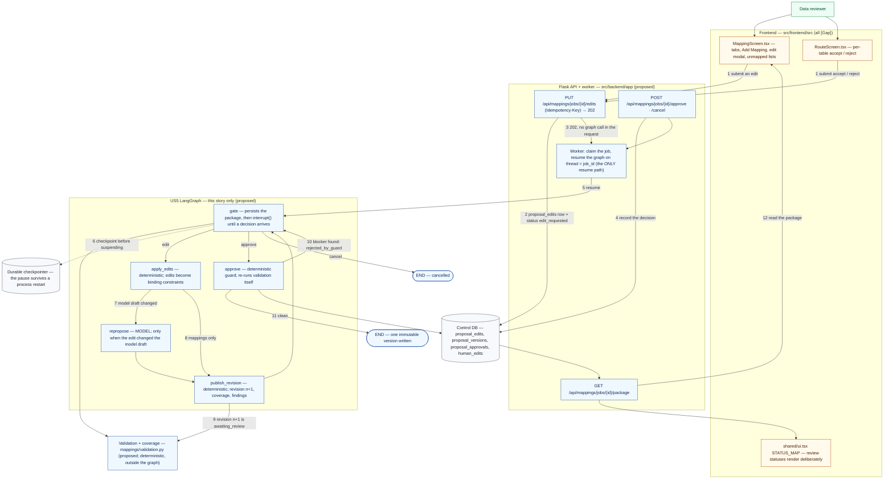

# US5 — Review and modify mappings

**Status:** Proposed implementation plan — planning document only. Nothing in this file is implemented.
**Acceptance-criteria source:** `src/frontend/src/imports/GenLedge_Connector_MVP_User_Stories.pdf` (US1–US7), quoted not paraphrased.
**Scope of this document:** the **US5-only** LangGraph integration — its graph, its state, the edit and approval contracts, its integration points, its tasks and its tests. It is written to be usable on its own.
**Shared registers (linked, not restated):** [`../LANGGRAPH_HARNESS_PLAN.md`](../LANGGRAPH_HARNESS_PLAN.md) §4.4 (who may resume), §5.3 (contract conventions), §5.6 (reducers), §5.9 (checkpointing and recovery), §7 (prompt construction), §9 (failure taxonomy, statuses), §11 (test layers), §12.2 (`proposal_edits`, `proposal_approvals`), §12.3 (phase gates), §16.5 (the cross-story task register, authoritative for task id, priority, owner and evidence), §18 (the end-to-end demonstration). **That document is not modified by this plan.**

*PDF story:* "As a data reviewer, I want to review and modify source-to-warehouse mappings in order to ensure that my data is mapped correctly before it is loaded."

**This story's design is deliberately independent.** US5's graph is not US4's graph continued, and it is not invoked by US6; the review package it reads is US4's *output data*, not a call into US4's graph. §11 records the dependencies the acceptance criteria actually create.

---

## 1. Acceptance criteria, current status and remaining work

| AC | Acceptance criterion (source wording) | Current status (repository evidence) | Remaining work in the D2 slice | Tasks | Blocking decision |
| --- | --- | --- | --- | --- | --- |
| **US5-AC1** | Open a visual Mapping Studio for a pipeline | **Partial.** `MappingScreen.tsx` exists and is reachable from the sidebar, but it is addressed by nothing: it takes no pipeline or job identifier and lives inside a demo shell that hard-codes the file `AMER_Orders_2026Q3.xlsx` | Give the studio a job id from the route, and fetch its package | `D2-FE-2`, `D2-BA-1` | — |
| **US5-AC2** | Display source fields and target warehouse columns | **Partial.** Both lists exist, but the source list comes from a *different screen's* private constant (`DiscoverScreen.tsx`'s `FIELD_DATA`), so the two sides are not guaranteed to agree | Render both sides from one package contract, so a disagreement is impossible | `D2-BA-1`, `D2-FE-2` | One package contract must be the single source for both |
| **US5-AC3** | Create a mapping manually | **Missing.** `"Add Mapping"` is rendered with no `onClick` (`MappingScreen.tsx:102`) | Wire the control to a real create flow that round-trips through the API | `D2-FE-2`, `D2-BA-2` | — |
| **US5-AC4** | Delete a mapping | **Partial.** `deleteMapping` exists against component state | Persist the deletion and restore it on reload | `D2-FE-2`, `D2-BA-2` | — |
| **US5-AC5** | Edit an existing mapping | **Partial, with a defect.** The `Edit Mapping` modal exists, but saving assigns `confidence: undefined` (`MappingScreen.tsx:48`), silently discarding the AI's confidence — a direct contradiction of US4-AC7 once the proposal is real | Fix the destructive save; route the edit through the API | `D2-FE-2`, `D2-BA-2` | — |
| **US5-AC6** | Persist mapping changes so they remain after leaving and reopening the studio | **Missing.** All edits live in component state; a reload discards them | Persist edits and revisions, then prove it with a reload | `D2-PF-1`, `D2-BA-2`, `D2-FE-2` | **This is the criterion that makes persistence a D2 P0**; `DC-5` (tenancy for D2) |
| **US5-AC7** | Switch between sibling target tables using the studio tabs | **Partial.** Tabs for `fact_orders`, `fact_order_lines`, `dim_customers` exist over a fixture map (`INITIAL_MAPPINGS`) | Drive the tabs from the approved-vs-proposed table list in the package | `D2-FE-2` | — |
| **US5-AC8** | Inspect and correct AI-generated mappings | **Partial.** Confidence is displayed for fixture rows; "correct" writes to component state | Requires a real proposal to correct, plus the edit path that applies it | `D2-LG-1`, `D2-FE-2`, `D2-LG-4` | — |
| **US5-AC9** | Identify unmapped source fields and unmapped target columns | **Partial.** `unmapped` counts come from fixtures in two screens; no coverage computation exists | Compute coverage once and render both sides from it | `D2-DM-1`, `D2-FE-2` | — |
| **US5-AC10** | Use the AI mapping feature to suggest mappings with confidence, reasons, and gaps | **Partial (fixtures only).** Confidence and `reason` exist; "gaps" has no representation | Render live confidence and reason; "gaps" cannot be represented until the vocabulary exists | `D2-LG-2`, `D2-DM-1` | `DC-2` (gap/reason vocabulary) |
| **US5-AC11** | Use the Mapping Assistant to make bounded natural-language mapping changes for the selected pipeline | **Not implemented.** `MappingScreen.tsx:59` echoes the prompt after an 800 ms timer and prints "…This is a prototype demo." | **None in D2** — deferred by decision, not by omission | **Post-D2** (`Q9`) | `D2-FE-7` keeps it honestly labelled; deferring it does not weaken AC3–AC9 |
| **US5 gap** | "Some mapping and transformation save failures are currently swallowed by the studio instead of being surfaced clearly to the reviewer." | **Current, as described.** Save handlers do not surface failure | Every 4xx/5xx produces a visible message and a retry; a swallowed failure is an AC failure | `D2-BA-3`, `D2-FE-3` | — |

**Status vocabulary used above:** **[Current]** exists in the tree · **[Gap]** described in a document but not implemented · **Partial** a UI affordance or fixture exists without the contract behind it. `US5-AC6` is the one criterion here that cannot be met by frontend work at all: it is the reason the D2 slice needs a real database, and the reason `D2-PF-1` is on the critical path rather than deferred.

**Remaining work by layer, in one view:** frontend (`D2-FE-2`, `D2-FE-3`, `D2-FE-5`); API (`D2-BA-2`, plus shared `D2-BA-1`, `D2-BA-3`); backend-domain (`D2-DM-1`); LangGraph/model (`D2-LG-4`); persistence (`D2-PF-1`); deployment (`D2-D-1`).

**Rejected as a solution:** a local-state fix. AC6 is a persistence criterion and the swallowed-failure gap is a failure-surfacing criterion; neither is reachable from `MappingScreen.tsx` alone.

---

## 2. Current implementation status, in detail

| Surface | Evidence | What it actually does |
| --- | --- | --- |
| `src/frontend/src/features/mappings/MappingScreen.tsx` | `INITIAL_MAPPINGS` (line 7) keyed `fact_orders` (5 rows), `fact_order_lines` (4), `dim_customers` (2); row shape `{src, tgt, type, transform?, confidence?, ambiguous?}`; `useState(INITIAL_MAPPINGS)` (line 29) | Renders fixtures from component state. Tabs, delete and the edit modal all mutate that state only. |
| `MappingScreen.tsx` — `Edit Mapping` save | assigns `confidence: undefined` (line 48) | **Actively destructive**: it discards the AI's confidence on any edit, which contradicts US4-AC7 the moment the proposal is real. |
| `MappingScreen.tsx` — `"Add Mapping"` | rendered without `onClick` (line 102) | An inert control: the AC's affordance is visible but not connected. |
| `MappingScreen.tsx` — Assistant panel | `MappingScreen.tsx:59` echoes the prompt after an 800 ms timer and prints "…This is a prototype demo." | The AC11 capability is explicitly a prototype; `D2-FE-7` must keep that label rather than let it drift into an implied feature. |
| `src/frontend/src/shared/ui.tsx` `STATUS_MAP` | line 32; keys are exactly `ready, success, active, connected, parked, pending, scheduled, failed, error, running, ingesting, processing, draft, manual, new, proposed`; `StatusPill` falls back to `'neutral'` (line 55) | The review states this story needs — `awaiting_review`, `edit_requested`, `approval_requested`, `cancelling` — are not in the map, so they render as neutral pills with no distinction. |
| `src/frontend/src/features/auth/client.ts` | the only HTTP client; 15 s `AbortController` | Nothing in the studio calls it. Every save is local. |
| `src/backend/app/mappings/` | `__init__.py` docstring only | No service, no routes, no models, no validation. |
| `src/backend/app/runs/`, `app/pipelines/`, `app/sources/` | docstring only | Nothing computes or persists a mapping decision. |

---

## 3. Does US5 need LangGraph?

Justified operation by operation. This is the evaluation the graph has to survive.

| Operation | What it really is | Needs graph mechanics? |
| --- | --- | --- |
| Deterministic validation of every revision | Pure functions over the contracts, run after each change | **No — and it must stay outside the graph**, because it also runs at approval time, in the API's pre-checks and in tests. |
| Applying a reviewer's edit to the revision | Deterministic transformation of persisted values | **No.** It is a function: `(revision, edits) → revision+1`. |
| Recording the reviewer's decision | A row, an audit entry, a status change | **No.** The API owns this; the graph never writes reviewer identity. |
| **Suspending until a human decides, for days, and then resuming** | A pause whose duration is unbounded, whose resumption may arrive from a **different process**, and whose enclosing node must be safe to re-run | **Yes — this is the entire reason LangGraph is here.** `interrupt()` plus a durable saver is a real, load-bearing mechanism: it makes the pause and the re-entry first-class instead of a status column plus bespoke reconstruction code. |
| Regenerating the parts a *structural* edit invalidates | Model-assisted reasoning, bounded to the affected area | **Only in that branch.** A mapping-level edit (retarget, operation change, delete) needs **no** model call at all — and that is the whole D2 slice. |
| External data or tool access | Nothing in this story reads a source or calls a tool | **No tools in US5's graph.** The critic has no tools, and neither does the edit path. |

**Verdict: US5 is the strongest LangGraph case in the plan, and the honesty requirement is to name exactly what earns it.** The graph is five nodes — `gate` (the interrupt), `apply_edits`, `repropose` (model, conditional), `publish_revision`, `approve` (the re-validating guard) — and four of the five are deterministic. What the graph buys is one thing: **the resume**. Everything else in the story is service code.

**The counter-argument, stated rather than hidden.** A human review gate *can* be built as a plain status machine: a row with a status, an endpoint that records a decision, and a service that recomputes the package on demand. US5's design deliberately makes that possible — §6.3 requires the review package to be readable **without** the graph. So if the D2 slice runs without a durable saver (`DC-7`), the graph is decoration around five functions, and the honest D2 path is the plain status machine with the graph labelled as debt. The graph earns its place **only** when the saver is durable: that is what makes a multi-day pause survivable and an edit applied after a restart actually applied.

**And one thing this story must do that the earlier unified plan did not state.** The model's revision budget (`max_revisions`) exists to stop an unproductive *model* loop. A reviewer may legitimately need five rounds. If the budget predicate counts `revise` invocations without distinguishing who asked, a persistent reviewer fails the job. See §9.3.

---

## 4. The US5 graph

### 4.1 US5 workflow

Proposed components are blue; **[Gap]** marks a current screen that does not yet do this.



Two properties this diagram is meant to make visible: the **only** resume path is the worker (edge 5), and the reviewer reads **persisted rows** (edge 12), so the studio works even when no checkpointer is available.

### 4.2 Nodes

| Node | What it does | Writes | Load-bearing rule |
| --- | --- | --- | --- |
| `gate` | Persists the reviewable revision, exposes it, and suspends via `interrupt()` until a decision arrives; on resume, records the decision and routes | `resume_decision`, `human_edits` (appended on an edit-resume), `status`, `updated_at` | **Persist before interrupting**; the node must be safe to **re-run**, because `interrupt()` restarts the enclosing node. Reviewer identity is never written into state — it lives on the audit rows. |
| `apply_edits` | Turns the submitted edits into changes to the revision's mappings; an edit is never written into a draft directly | `mapping_draft`, `model_draft` (only if a structural edit requires it), `unresolved_refs`, `updated_at` | An inapplicable edit is **never dropped** — it becomes an unresolved item that keeps blocking approval until applied or explicitly withdrawn. A `remove` of a table other mappings depend on is recorded, not silently applied. |
| `repropose` | Model-assisted regeneration, scoped to what the structural edit invalidated | `model_draft`, `model_calls_used`, `tokens_used`, `messages`, `status`, `failure`, `updated_at` | **Not entered in the D2 slice** (§9.1). When it changes the model draft it clears the mapping draft, so no mapping built against the old structure survives. |
| `publish_revision` | Writes revision *n+1*, recomputes coverage and findings, returns the job to `awaiting_review` | `revision_count`, `validation_findings`, `unresolved_refs`, `status`, `updated_at` | Assigns `revision`/`based_on_model_revision` itself. Human edits win over a contradicting model revision, and the contradiction is recorded as unresolved — the package is **not** marked clean. |
| `approve` | Turns the reviewed revision into one immutable version | `approval_ref`, `validation_findings` (from its own re-check), `unresolved_refs`, `status`, `updated_at` | **Re-runs deterministic validation itself.** If a blocker is now present it does **not** approve: it records `review_decision=rejected_by_guard`, leaves `approval_ref` unset, and returns to `gate` **with the new blocker list in the payload**. |

### 4.3 Edges, routing and loop bounds

| Edge | When |
| --- | --- |
| `START → gate` | The job already has a published revision (US4's output) — US5's graph does not re-propose from scratch. |
| `gate → apply_edits` | `resume_decision = "edit"`. |
| `gate → approve` | `resume_decision = "approve"`. |
| `gate → END` | `resume_decision = "cancel"` → `cancelled`. |
| `apply_edits → repropose` | The edit changed the **model draft** (a structural edit). |
| `apply_edits → publish_revision` | Mappings only — **the D2 path**, no model call. |
| `repropose → publish_revision` | Always. |
| `publish_revision → gate` | Always — the reviewer is asked again, with the new revision. |
| `approve → END` | Its own re-validation passed and the immutable version was persisted. |
| `approve → gate` | A blocker was found; the reviewer is told why, not shown an identical screen. |

**Two bounds, deliberately different in kind.** (1) The *model's* revision loop is bounded by `AgentBudgets.max_model_calls` and by a revision budget the router checks before entering `repropose`. (2) **A reviewer's edits are not bounded by that budget.** `gate → apply_edits` must be reachable an arbitrary number of times; a person who needs four rounds of correction must not fail a job. The budget predicate therefore has to distinguish *who asked for this revision*, which the earlier unified plan did not state — §9.3 records it as a finding to reconcile at the Phase-1 contract review rather than as something this document has fixed.

`recursion_limit` is derived (master §6.5) so the semantic budgets fire first. Note this makes US5's graph the one place where a derived limit is *not* sufficient on its own: an unbounded human loop needs its own guard on the **API** side (a per-job rate/idempotency rule, not a graph counter).

### 4.4 Minimum graph state

**Provisional, and US5-only.** It is not evidence that US4 and US6 use one shared state schema; see §11.

```python
class ReviewState(TypedDict):
    job_id: str
    revision_id: str                     # the revision currently under review
    revision_count: int
    model_draft: ModelDraft | None        # imported from the shared contract set (master §5.3)
    mapping_draft: MappingDraft | None
    human_edits: Annotated[list[HumanEdit], append_unique_edits]   # deduplicated by `edit_id`
    validation_findings: list[ValidationFinding]
    blockers_for_current: list[ValidationFinding]   # filtered to the revision they reviewed
    resume_decision: Literal["edit", "approve", "cancel"] | None
    approval_ref: str | None
    status: Literal["awaiting_review", "edit_requested", "approval_requested",
                    "cancelling", "blocked", "approved", "failed", "cancelled"]
    failure: FailureInfo | None
    updated_at: str
```

Conventions (master §5.3, §5.6, not repeated here): `append_unique_edits` deduplicates by `edit_id`; `resume_decision` is **cleared** by every node that consumes it, so a replayed resume cannot re-apply an old decision; a node's `Writes` list in §4.2 is enforced by a state guard. Note there is **no** `messages` field: US5 performs no conversational reasoning in the D2 slice, and adding a message list would be the first step towards an agent framework this story does not need.

### 4.5 Not in this graph, on purpose

`context`, `propose`, `tool_call` (US4's), the transform compiler and loader (US6's), and any tool execution. US5 reads a published package and writes a decision.

---

## 5. Contracts and data model

### 5.1 Review-package contracts

Defined in `app/agent/contracts.py` **[Proposed]**; the shared conventions (`StrictModel`, harness-assigned fields, versioning) are in master §5.3.

```python
class Critique:                 findings: list[CriticFinding]
class CriticFinding:            # MODEL-FACING: what a model can know
                                kind: str; target: Identifier; severity: Severity
                                message: str (1–500); material: bool
                                # NOTE: no `revision` field — a model cannot know it
class CriticFindingRecord(CriticFinding):   # STORED: adds the harness-owned key
                                revision: int   # assigned by semantic_review, never by the model
class ValidationFinding:        severity: Severity; code: str; target: Identifier
                                message: str; revision: int   # assigned by the producing code
                                source: "validation"
class HumanEdit:                edit_id: str        # server-assigned idempotency key
                                kind: EditKind; target: Identifier
                                payload: dict; note: str | None
                                # reviewer identity lives in proposal_edits, not in state
class FailureInfo:              code: str; message: str; retryable: bool
                                detail: dict
```

The split between `CriticFinding` and `CriticFindingRecord` is not stylistic. Routing filters findings by the revision they reviewed (`blockers_for_current`, regression R3); a model-writable `revision` would let a model defeat that filter, and a model-*invisible* one has to be assigned somewhere — so the model-facing type simply has no such field, and the stored type requires it. `Critique.model_json_schema()` is what the prompt injects, so harness-owned fields stay out of the model's view automatically.

**[Proposed] `EditKind`** — the plan's own rules and tests imply at least: retarget a mapping, rename a target, set or clear an operation, remove or add a mapping, remove a table, and withdraw a previously submitted edit. The **exact enum is part of the Phase-1 contract freeze**; it is enumerated here rather than silently invented, and `DC-2`'s reason-code work is the natural place to close it, since an inapplicable edit must produce a stated reason.

### 5.2 Job and revision status

Eleven job statuses exist in the canonical list (master §9.6). The five this story's surface must render correctly, and why:

| Status | Why the studio must distinguish it |
| --- | --- |
| `awaiting_review` | The only state in which approve is even attempted; it is **not** the same as "the job is fine" — blockers may still be present |
| `edit_requested` | An edit is persisted but the graph has not consumed it yet. Without this state, "the reviewer clicked save and nothing happened" is silent |
| `approval_requested` | An approval was accepted and the node's own re-validation is running; if the process dies here, the durable claim + stale-heartbeat path resumes it |
| `cancelling` | A stop was requested but has not taken effect — distinct from `cancelled` so an operator can tell the two apart |
| `blocked` | **Not a failure.** The harness worked and the proposal is not yet good enough; the reviewer's routes are edit or abandon |

`shared/ui.tsx`'s `STATUS_MAP` contains none of these, so today each would render as an undifferentiated neutral pill. Rendering them deliberately is `D2-FE-5`, and it is not cosmetic: a reviewer who cannot tell `edit_requested` from `awaiting_review` will approve a revision that does not contain their edit.

### 5.3 What the API persists, and what the graph may not

| Record | Contents | Owner |
| --- | --- | --- |
| `proposal_edits` | `(job_id, edit_id)` unique; reviewer, role, timestamp, `Idempotency-Key`, `before_hash`/`after_hash`, `applied_at` | The **API** writes the row; the graph only consumes the edit |
| `human_edits` (in graph state) | The edits the graph has been asked to honour, deduplicated by `edit_id` | The graph, via `append_unique_edits` |
| `proposal_versions` | One immutable row per approved revision — **the only thing US6 may execute** | The `approve` node, through a persistence service |
| `proposal_approvals` | `(revision_id, reviewer, decision)` unique, so two concurrent approvals collapse to one | The **API** |

The rule that keeps this honest: **the graph never writes reviewer identity, and the API never resumes the graph.** They meet at the rows above.

---

## 6. Rules this story must not weaken

### 6.1 The edit-delivery contract

| Step | Owner | Rule |
| --- | --- | --- |
| 1 | Reviewer | `PUT /api/mappings/jobs/{id}/edits` with an `Idempotency-Key` header and one or more edits |
| 2 | API | Validate the **role**; validate each edit's shape against its `kind`; compute `before_hash`/`after_hash` against the current revision; insert `proposal_edits` rows keyed by `(job_id, edit_id)`; set the job row to `edit_requested`; return `202`. A repeated `Idempotency-Key` returns the original result and inserts nothing |
| 3 | Worker | Claim and resume the graph on the job's thread with the edit decision |
| 4 | `gate` | Append the edits to `human_edits` — deduplicated by the `append_unique_edits` reducer — and route to `apply_edits` |
| 5 | `apply_edits` → `publish_revision` | Apply them as **binding constraints** and persist revision *n+1*; the job returns to `awaiting_review` |
| 6 | Reviewer | Approve — and the request is **refused with `409 edits_pending`** while an edit exists that the current revision does not incorporate |

Step 6 is the load-bearing one. Both `MappingScreen.tsx` and `RouteScreen.tsx` are edit-then-approve screens, so without the guard the natural UI flow would record the edits and then approve the **unedited** revision — producing an immutable version that contradicts the reviewer's explicit decision, with no error anywhere, because both requests succeeded. That is the guarantee this story exists to protect.

### 6.2 Corrections that must survive into the studio

- **Editing must not destroy confidence.** US5-AC5's current implementation sets `confidence: undefined`; `D2-FE-2`'s evidence explicitly requires that editing preserves it.
- **Edits go through validation like any other change.** An edit is never written into the draft directly, so "changing a target schema field invalidates its dependent mappings and checks" is enforceable: a structural edit bumps the model draft's revision, `mapping_draft.based_on_model_revision` no longer matches, and the job is remapped instead of leaving stale mappings in place.
- **An inapplicable edit is never dropped.** A `remove` of a table that mappings depend on, or an edit with an unknown target, is recorded and returned to the reviewer as an unresolved item on the next revision. It keeps blocking approval until it is applied or explicitly withdrawn — a reviewer never silently loses a correction.
- **A model revision may not contradict an edit.** If the model proposes something a human edit forbids, the edit wins and the contradiction is recorded as an unresolved item; the package is not marked clean.
- **Edits are append-only.** The audit trail is `human_edits` plus `proposal_edits` (reviewer, role, timestamp, idempotency key, before/after hashes). Nothing is mutated in place.
- **Approval is idempotent and re-validated.** `approve` re-runs the deterministic checks itself; if a blocker is now present it records `review_decision`/`rejected_by_guard`, leaves `approval_ref` unset, and returns to `gate` **with the new blocker list in the payload** so the reviewer is told why rather than shown an identical screen.

### 6.3 Error paths, security constraints and recovery

| Situation | Required behaviour |
| --- | --- |
| Save fails (the US5 gap) | A visible error with a retry. Every 4xx/5xx carries a `{"error": {"code", "message"}}` body (the envelope `app/auth/routes.py` already returns); a swallowed failure is an AC failure |
| Approve with unapplied edits | `409 edits_pending`, **the graph is never resumed**, and the response names the pending edit ids |
| Approve with blockers | `409 blockers_present`, with the blocker codes |
| A blocker appears between the API's check and the node's re-validation | The node records `rejected_by_guard` and re-interrupts with the blocker list; the job does not end `approved` |
| Duplicate edit submission | One `proposal_edits` row and one `edit_applied` event per `edit_id`; `human_edits` holds one entry; the second resume is a no-op or `409`; exactly one revision is produced |
| Viewer attempts to edit or approve | `403` **before any graph call**; no approval row; no resume. `reviewer_role` is stored on the audit rows so the check is attributable |
| Two actors approve concurrently | `(revision_id, reviewer, decision)` is unique; the second approval returns the existing version |
| Cancel races a resume | Both are conditional status updates on the same row: whichever commits first wins, the loser sees zero rows updated and returns `409`. A winning cancel ends the run at the next node boundary |
| Checkpoint lost before a resume | Reconstruction from the control DB, re-entry at `gate` on a **fresh** thread, `proposal_jobs.active_thread_id` repointed. Reviewer decisions recorded before the loss are still present |
| Prompt injection reaches the reviewer's screen | Untrusted source text is delimited and rendered as data; the reviewer is the last line of defence, which is why an unapplied edit and a visible blocker list matter more here than anywhere else |

**Recovery boundary specific to this story:** the durable package is what makes a multi-day review pause survivable, so the **review package must be readable without the graph**. A reviewer opening the studio after a restart reads persisted rows; only the resume needs the checkpointer. If the D2 slice runs without a durable saver, that must be labelled as debt (`DC-7`), because it removes the property this story is about.

---

## 7. Frontend and backend integration

Every row names a real path. **[Proposed]** marks an endpoint or component that does not exist today.

| # | Interaction | Screen / component | API operation | Validation and error feedback | States the user sees | What must persist | How the user confirms success | Tasks |
| --- | --- | --- | --- | --- | --- | --- | --- | --- |
| 1 | Open the studio for a job | `MappingScreen.tsx` — today takes no job id and titles itself from a hard-coded file name | **[Proposed]** `GET /api/mappings/jobs/{id}/package` | a package that fails its schema renders an error, never a partial studio | loading → tabbed tables | the revision, its mappings and its coverage | the studio's tables match the routing results for the same job | `D2-FE-2`, `D2-BA-1` |
| 2 | See source fields against target columns | `MappingScreen.tsx` both panels — the source side currently borrows `DiscoverScreen.tsx`'s `FIELD_DATA` | same package response | one contract for both sides; a mismatch is impossible by construction | two aligned lists | nothing new — it is a read | the source side and the target side come from one payload | `D2-FE-2`, `D2-BA-1` |
| 3 | Add, edit or delete a mapping | `MappingScreen.tsx` — `"Add Mapping"` has no `onClick`; the edit modal discards confidence; delete is local | **[Proposed]** `PUT /api/mappings/jobs/{id}/edits` (idempotency key) | a rejected edit shows its reason; a save failure shows a message and a retry | `edit_requested` → `awaiting_review` | `proposal_edits` row + the new revision | **the value, including confidence, is still shown after a page reload** | `D2-FE-2`, `D2-FE-3`, `D2-BA-2`, `D2-LG-4` |
| 4 | Apply an operation the product forbids | `MappingScreen.tsx` transform picker — e.g. `date_format` on the ambiguous `order_date` | the API's validation, then the graph's | blocked **with an explanation**; this is the designed outcome, not a bug | a blocker badge on the row, save disabled | the blocker on the revision | the attempt is refused and the reason names the ambiguity | `D2-FE-3`, `D2-DM-1` |
| 5 | Switch sibling target tables | `MappingScreen.tsx` tabs — driven today from `INITIAL_MAPPINGS` | same package response | a table with no mappings shows an empty state, not a blank panel | one tab per target table in the package | nothing new | the tab list equals the proposal's table list | `D2-FE-2` |
| 6 | See what is unmapped | `MappingScreen.tsx` `unmapped` counts, from two different fixtures today | same package response (`coverage`) | counts reconcile with the routing screen's numbers | two count lists | coverage computed per revision | both screens show the **same** number for the same revision | `D2-FE-2`, `D2-DM-1` |
| 7 | Approve | `MappingScreen.tsx` / `RouteScreen.tsx` — no approve control exists today | **[Proposed]** `POST /api/mappings/jobs/{id}/approve` | `409 edits_pending` and `409 blockers_present` must be **visibly different** to the reviewer | `approval_requested` → `approved`, or back to `awaiting_review` with reasons | the immutable version + the approval row | the version is immutable and the job is `approved`; reloading shows the same | `D2-BA-2`, `D2-LG-4`, `D2-FE-2` |
| 8 | Submit the same edit twice | same screen, same button | same `PUT`, second call | the second returns success **and changes nothing** | no visible flicker; status returns to `awaiting_review` | one `proposal_edits` row per `edit_id` | one revision exists for the two identical submissions | `D2-BA-2` |
| 9 | Cancel | no control exists today | **[Proposed]** `POST /api/mappings/jobs/{id}/cancel` | a cancel racing a resume returns `409` on the loser | `cancelling` → `cancelled`, distinct from `failed` | the job's terminal status | the job stops and the two states are distinguishable | `D2-BA-2`, `D2-FE-5` |
| 10 | Read reviews states honestly | `shared/ui.tsx` `STATUS_MAP` (line 32) has none of the five review statuses | n/a — a rendering fix | an unknown status must never render as a neutral pill by accident | five deliberately mapped pills | nothing — status comes from the job row | `awaiting_review`, `edit_requested`, `approval_requested`, `cancelling` and `blocked` are visually distinct | `D2-FE-5` |
| 11 | Use the Mapping Assistant (AC11) | `MappingScreen.tsx:59` — the 800 ms echo | none | must stay labelled as not implemented | an explicit "not implemented" state | nothing | the screen does not imply a capability the code lacks | `D2-FE-7` |

**Proposed components introduced by this table:** `PUT …/edits`, `POST …/approve`, `POST …/cancel` (ids `D2-BA-2` in master §16.5), and a job/package type in `src/frontend/src/app/types.ts`. **Reused, not duplicated:** `features/auth/client.ts` as the HTTP client, and `shared/ui.tsx`'s `StatusPill`.

---

## 8. Task register

Field meanings per the plan's standard: **Layer** FE frontend · API API contract · BD backend-domain · LG LangGraph/model · P persistence · FH failure handling · TS testing · D demonstration. **Priority** D2 P0 = in the frozen snapshot, or the demonstration cannot run · D2 P1 = lands only if P0 is safe · Post-D2 = explicitly out. Owners are placeholder slots filled in the Phase 0 ADR; **no assignment is invented here.** **Verification** is the same column master §16.5 calls "Evidence" — the master stays authoritative for it.

| Task ID | Acceptance criteria | Work | Layer | Priority | Dependencies | Owner | Verification |
| --- | --- | --- | --- | --- | --- | --- | --- |
| `D2-BA-2` | US5-AC3, AC4, AC5, AC6, the US5 gap | `PUT …/{id}/edits` (requires an `Idempotency-Key`), `POST …/{id}/approve`, `POST …/{id}/cancel`, with the `409 edits_pending` and `409 blockers_present` guards and a `403` for a viewer | API | **D2 P0** | `D2-BA-1` | `<backend-owner>` | Tests for a duplicate key, an approve-while-edits-pending, an approve-while-blocked, and an edit by a viewer — all with **no model call and no network** |
| `D2-LG-4` | US5-AC3, AC5, AC6, AC8 | The human-edit resume: `gate` suspends via `interrupt()`, `decision="edit"` → `apply_edits` → `publish_revision` with the edits as **binding constraints**, on a durable saver; `repropose` is present but **not entered** in D2 | LG / FH | **D2 P0** | `D2-BA-2`, `D2-PF-1`, `D2-LG-1` | `<agent-owner>` | An edited mapping is applied and observable after a reload; a second identical submission changes nothing; an approve-while-pending-edits never resumes the graph |
| `D2-FE-2` | US5-AC1, AC2, AC3, AC4, AC5, AC6, AC7, AC9 | Wire `MappingScreen.tsx` to the package: source fields against target columns, unmapped lists from one computation, tabs across sibling tables, working create/edit/delete persisted through `PUT …/edits`, and a reload that restores the saved state | FE | **D2 P0** | `D2-BA-1`, `D2-BA-2`, `D2-LG-4` | `<frontend-owner>` | Add Mapping works; **editing preserves confidence**; a reload shows the saved mapping and the same unmapped counts as the routing screen |
| `D2-FE-3` | US5-AC5, US5-AC8, the US5 gap | Failure surfacing: replace the swallowed save failures, render invalid-reference and unmapped reasons, distinguish `409 edits_pending` from `409 blockers_present`, and carry the ambiguous-date badge through to the studio | FE | **D2 P0** | `D2-BA-3`, `D2-DM-1` | `<frontend-owner>` | A forced server error produces a visible message and a retry, not a silent no-op; the two `409` classes read differently |

**Shared tasks this story depends on, defined once in master §16.5 and not repeated here:** `D2-PF-1` (control tables — **US5-AC6 is the criterion that makes it P0**), `D2-BA-1` (package endpoint), `D2-BA-3` (error envelope), `D2-DM-1` (validation, coverage, reasons), `D2-LG-1` (the proposal being reviewed), `D2-FE-5` (status vocabulary), `D2-FE-7` (honest labels), `D2-TS-2` (contract tests), `D2-TS-4` (R1/R2/R5 regressions).

**Acceptance criterion closed only by shared tasks:** `US5-AC10` — its confidence-and-reason half lands in `D2-LG-2`, and its "gaps" half stays unrepresentable in `D2-DM-1` until `DC-2` is decided. This story owns no task for it.

**Post-D2 and deliberately not in the D2 slice:** the Mapping Assistant (`US5-AC11`, `Q9`); `repropose`'s structural-edit branch; role-restricted approval if `DC-5` resolves to a single role; multi-process resume; the supersession-history view ("a running pipeline is unaffected by a later edit"); and R3/R4/R6/R7 as automated regressions.
**Cut order if the schedule slips** (master §17.2): `D2-FE-5` and the supersession view first (cosmetic). **No cut in this story may remove the `409 edits_pending` guard or the edit idempotency key** — those are the two mechanisms that make the review gate honest.

---

## 9. Testing and demonstration

### 9.1 Tests

| Level | Test | Pass criterion |
| --- | --- | --- |
| Integration / graph | `test_path_human_edit_not_lost` (**R1**) | With the job `awaiting_review`, submit an edit and then approve as the same actor: approve is refused `409 edits_pending` (or the API forces the edit resume first); the persisted revision contains the reviewer's value; `proposal_edits` shows `edit_applied`, not merely `edit_received` |
| Integration / graph | `test_path_duplicate_edit_submission` (**R5**) | The same body with the same `Idempotency-Key` twice, then the same body with a different key: one row and one `edit_applied` per `edit_id`, one `human_edits` entry, exactly one revision, and the second resume refused or a no-op |
| Integration / graph | `test_path_stale_mapping_after_model_revision` (**R2**) | A structural edit that bumps the model draft's revision leaves `based_on_model_revision` mismatched; the job is remapped rather than left with stale mappings. **Not reachable in the D2 slice** (`repropose` is out) — it is written but marked skipped with this reason |
| API contract | `D2-BA-2` suite | Duplicate key; approve-while-edits-pending; approve-while-blocked; a viewer's `403` before any graph call; the error envelope shape for each class; no model call and no network |
| Graph, negative | re-validation after approval | A blocker appearing between the API's check and the node's re-check ends the job **not** `approved`, records `rejected_by_guard`, and re-interrupts with the new blocker list |
| Graph, negative | unbounded reviewer loop | Ten successive edits from one reviewer all apply, and the job is **still resumable** — the model's revision budget does not bound a human (§4.3) |
| Graph, negative | cancel races a resume | Exactly one of the two wins; the loser sees `409`; the winning cancel ends the job `cancelled`, distinguishable from `failed` |
| Recovery | readable without a checkpointer | After a process restart, `GET …/package` returns the current revision and its blockers with the graph never resumed |
| Frontend | `D2-FE-2` reload test | Edit a mapping, reload the page, and the saved value — **including confidence** — is still shown |
| Frontend | `D2-FE-3` failure test | A forced server error on save produces a visible message and a retry |
| Frontend | status rendering | `awaiting_review`, `edit_requested`, `approval_requested`, `cancelling` and `blocked` each render distinctly, never as a neutral pill |

Run with `py -3 -m pytest tests` from `src/backend/` (`python` is not on `PATH` on the development machine). **No CI exists in this repository today**, so no criterion here may cite "CI enforces it" until `D2-TS-3` lands.

**Explicitly not claimed:** none of these tests has been written or run; no graph has ever suspended or resumed; no reload has preserved anything.

### 9.2 Demonstration — US5's part of the end-to-end scenario

Steps 6–9 of the master's scenario ([master §18.2](../LANGGRAPH_HARNESS_PLAN.md)); step 7 is a **deliberate** failure demonstration. **Seeded data:** the `D2-PF-2` fixture, including the ambiguous `order_date`. **Mocked/stubbed:** the studio's source-side fields come from the seeded inventory, not a live connector; if `DC-7` selects a recorded response, the proposal being corrected is a labelled replay.

| Step | Action | Observable result | ACs |
| --- | --- | --- | --- |
| 6 | Open the repeating array's proposal from the routing results | Target column, merge key and any candidate date operation are shown, and the ambiguous-date marker survives into the studio | AC8, AC10 (partially — "gaps" needs `DC-2`) |
| 7 | Try to apply a `date_format` while the field is still flagged ambiguous | The attempt is **blocked, with an explanation**. This is the expected result, not a bug: the product rule is that an ambiguous date stays text until its interpretation is known | AC8 |
| 8 | Correct the mapping manually and save | The correction is saved; a page reload still shows it; the source-side unmapped list and the target-side unmapped columns both update | AC3, AC4, AC5, AC6, AC9 |
| 9 | Submit the same edit twice | The second submission changes nothing and reports success | AC6 (idempotency) |

Step 8 is also where the US5 swallowed-failure gap is demonstrated as closed: a save failure must show a visible error and a retry. The script must say that the Mapping Assistant is **not** implemented (AC11) and that the schedule modal does nothing — `D2-FE-7` exists so that no screen claims a capability the code does not have. If the D2 slice runs without a durable saver, the script must also say that the resume is in-process only (`DC-7`).

---

## 10. D2 scope, decisions and risks

### 10.1 Scope

| Horizon | Content |
| --- | --- |
| **D2 P0** (by 2026-10-23) | AC1, AC2, AC3, AC4, AC5, AC6, AC7, AC8, AC9 and the swallowed-failure gap, via `D2-BA-2`, `D2-LG-4`, `D2-FE-2`, `D2-FE-3` plus the shared `D2-PF-1`, `D2-BA-1`, `D2-BA-3`, `D2-DM-1`, `D2-FE-5`, `D2-FE-7`, `D2-TS-2` |
| **D2 P1** | `D2-TS-4`'s R1/R2/R5 regressions; the supersession-history view |
| **Not met in D2** | AC10's "gaps" until `DC-2` is decided; AC11 (Post-D2 by decision, not by omission) |
| **Post-D2** | the Mapping Assistant as a bounded second graph; `repropose`'s structural-edit branch; role-restricted approval and R6 if `DC-5` resolves to one role; multi-process resume; "a running pipeline is unaffected by a later edit" |

### 10.2 Open decisions, owners and deadlines

| # | Question | Owner | By | If unresolved |
| --- | --- | --- | --- | --- |
| `DC-5` | Persistence and tenancy for D2: the control tables, and whether the demo is single-organization with a single role | `<backend-owner>` + `<product-owner>` | Oct 13 | AC6 is undemonstrable and the review gate cannot persist. R6 becomes a documented deferral: the test is marked skipped with this as its reason, and **no phase may claim the "approval by a viewer is impossible" guarantee** |
| `DC-7` | Is the D2 slice run with a durable saver, or does the graph complete and a later edit start a new invocation? | `<agent-owner>` + `<product-owner>` | Oct 13 | The pause-and-resume property — the only reason US5 has a graph (§3) — is lost, and the D2 slice must be labelled as debt rather than presented as the §5.9 design |
| `DC-2` | The reason-code and gap vocabulary for invalid references, unmapped fields and AI-proposed "gaps" | `<product-owner>` + `<backend-owner>` | Oct 13 | `D2-DM-1` emits free text: AC9 and AC10 are met in substance but not machine-checkably, and the studio can only render prose |
| `DC-3` | Partial-success semantics when one table's proposal fails | `<product-owner>` + `<backend-owner>` | Oct 14 | Step 5 of the demo is dropped and US4-AC11 is reported as not demonstrated |
| `Q5` | Is the `origin/feature-login` persistence (SQLAlchemy + psycopg + `Organization`) reinstated, and do US1's admin/viewer roles exist with them? | `<backend-owner>` + `<security-owner>` | Phase 0 to decide; **Phase 6** to have in place | Contracts keep `organization_id` and `reviewer_role`, backed by one seeded organization and one role in development. The tenant check is then **present but untested**; approval records cannot be attributed to a role — an audit gap rather than a functional one, but a real one |
| `Q9` | Is the Mapping Assistant in scope for this iteration? | `<product-owner>` | Phase 6 | It stays deferred; the structured-edit flow — the part AC5/AC6/AC8 actually need — is unaffected |
| Phase-1 contract review | The exact `EditKind` enumeration, the `409` guard's precedence when edits *and* blockers are present, and **who a revision budget is allowed to bound** (§9.3) | `<agent-owner>` + `<backend-owner>` | Phase 1 | All three are implemented as this document writes them; a later change is a contract version bump plus a migration for persisted edits |

No question in this table is decided by this document. Each has an owner slot, a deadline, and a stated consequence.

### 10.3 Retained findings that still apply to US5

| Finding | Status here | Where it lands |
| --- | --- | --- |
| No edit idempotency key; `human_edits` could double-apply | **Addressed in design, not in code** | §6.1 step 1, `HumanEdit.edit_id` in §5.1, the `append_unique_edits` reducer in §4.4, and R5 |
| Approve could race a pending edit and produce an immutable version contradicting the reviewer | **Addressed in design, not in code** | The `409 edits_pending` guard in §6.1 step 6 — the single most important mechanism in this document |
| A model-writable `revision` on findings could defeat the staleness filter | **Addressed by the type split** | `CriticFinding` vs `CriticFindingRecord` in §5.1; R3 stays Post-D2 |
| The review surface reinterprets job status as a pill | **Open until `D2-FE-5`** | §5.2, row 10 of §7 |
| Security: approval must be attributable to a role | **Blocked on `DC-5`/`Q5`** | §6.3's viewer row; report as deferred rather than guaranteed if unresolved |
| **New here:** the model's revision budget could bound a reviewer's edits (§4.3) | **Open — raised by this story-level design** | The Phase-1 contract review row in §10.2. The earlier unified plan counted `revise` invocations without distinguishing who asked; this plan requires the predicate to distinguish them |

**Deliberately not carried into this document:** the shared failure taxonomy, the phase gates and the critical path. They live in the master plan; restating them here would create a second source of truth.

---

## 11. Cross-story notes and provisional interfaces

Recorded, not designed around.

| Interface | Why it exists | Verdict |
| --- | --- | --- |
| The review package (US4's output) | US5-AC1/AC2/AC8 need a real proposal to review | **A data handoff.** US5's graph does not call US4's graph, and US4's graph does not know US5 exists. The shape is the shared contract set in master §5.3 |
| `append_unique_edits` | The dedup-by-`edit_id` reducer is defined once in the master plan | **Reused.** One small, already-justified helper is not a framework |
| The worker and the durable saver | US4 and US5 both need a claimed job, a thread and a resume path — and US5 is where either one is actually load-bearing | **Reuse is warranted** (two concrete callers). Build once, in the master's §4.4 shape: the API records decisions, the worker performs every resume |
| `PUT …/{id}/edits` also serves US4-AC11's per-table accept/reject | One endpoint records human decisions; two stories submit them | **Shared endpoint, not a shared graph.** US5's plan owns its definition |
| `MappingDraft` / `ValidationFinding` | US5 displays and edits both | **Already shared by contract.** Do not fork a review-only copy of a contract the proposal also produces |
| `ReviewState` (§4.4) vs US4's `RoutingJobState` | Both carry `job_id`, a draft, revision counts and status; they differ everywhere that matters | **Provisional only.** Two similar-looking states are not proof a shared schema is warranted. Unify nothing until a third caller exists or a measured duplication cost does |

**Explicitly not created by this plan:** a master graph, a shared node library, a generic review framework, or a conversational agent loop. US5's graph has no `messages` field on purpose — the story is a review gate, not a chat.
