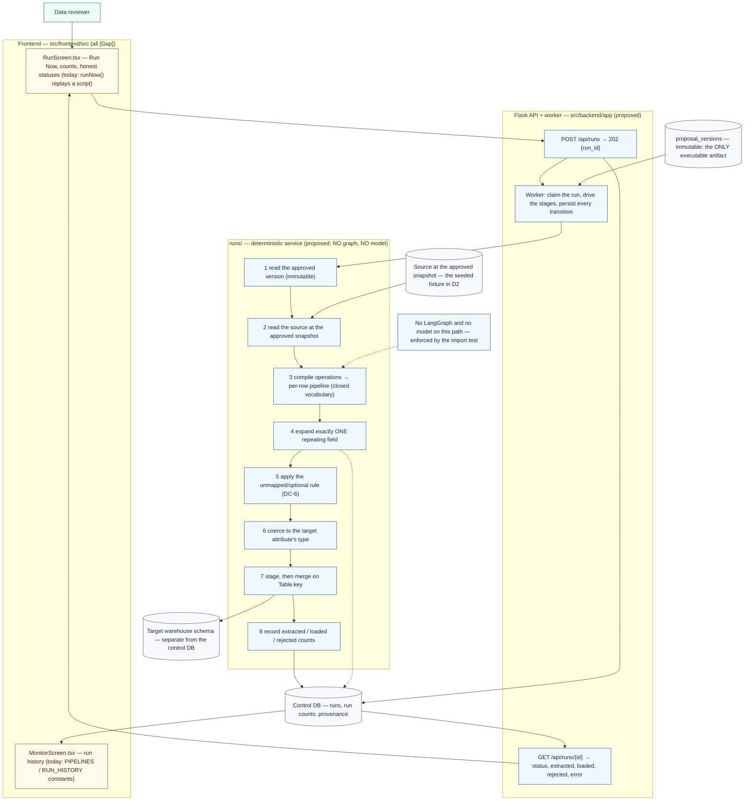

# US6 — Transform and load data

**Status:** Proposed implementation plan — planning document only. Nothing in this file is implemented.
**Acceptance-criteria source:** `src/frontend/src/imports/GenLedge_Connector_MVP_User_Stories.pdf` (US1–US7), quoted not paraphrased.
**Scope of this document:** the **US6-only** workflow — this story contains **no LangGraph and no model**, and §4 argues that position rather than assuming it. The document carries the canonical transformation vocabulary, the executor's rules, its integration points, its tasks and its tests.
**Shared registers (linked, not restated):** [`../LANGGRAPH_HARNESS_PLAN.md`](../LANGGRAPH_HARNESS_PLAN.md) §3.1 and §3.5 rule 6 (the execution boundary), §5.3 (the contracts the executor consumes), §9 (failure taxonomy, statuses), §12.2 (`proposal_versions` — the immutable approved version), §12.3 Phase 7, §16.5 (the cross-story task register, authoritative for task id, priority, owner and evidence), §18 (the end-to-end demonstration). **That document is not modified by this plan.**

*PDF story:* "As a data reviewer, I want GenLedge to transform and load mapped source data into the warehouse in order to produce clean, structured data for analytics."

**This story has no model in it.** Every step below — compile, expand, coerce, merge, count — is deterministic code. US6-AC8's merge behaviour and US6-AC9's runner/Glue parity are only meaningful if the path is reproducible, so a model anywhere in it is a defect, not an optimisation. §4 states what would have to change for that answer to change.

---

## 1. Acceptance criteria, current status and remaining work

| AC | Acceptance criterion (source wording) | Current status (repository evidence) | Remaining work in the D2 slice | Tasks | Blocking decision |
| --- | --- | --- | --- | --- | --- |
| **US6-AC1** | Allow a reviewer to run a pipeline immediately | **Missing.** `RunScreen.tsx`'s `Run Now` calls `runNow()`, which appends to a scripted log array on `setTimeout` timers | Create a real run through `POST /api/runs` and stop the screen from reporting success because a script says so | `D2-BA-4`, `D2-FE-4` | `D2-DM-3` |
| **US6-AC2** | Read the configured source and apply saved mappings and transformations | **[Gap].** No executor exists; `src/backend/app/runs/__init__.py` is a docstring | Build the executor's read and compile steps over the approved version and the seeded snapshot | `D2-DM-3` | `D2-DM-2`, `D2-PF-1` |
| **US6-AC3** | Write clean, typed records into the client's warehouse schema | **[Gap].** No target warehouse, no DDL path, no type coercion | Create the target schema from the approved version and load into it; never `ALTER` a populated target (see US4-AC10) | `D2-DM-3` | Target schema created from the approved version |
| **US6-AC4** | Record extracted and loaded row counts | **Partial (cosmetic).** The scripted log prints `Est. Source Documents: 48,203`; nothing is counted | Count for real and **persist** the counts so the API returns them | `D2-DM-3`, `D2-BA-4`, `D2-FE-4` | Counts must be persisted, not logged |
| **US6-AC5** | Allow one source document to produce multiple warehouse rows when repeating data is expanded | **[Gap].** US3's known gaps note that "leaves and whole arrays are the usable mapping units", so `orders.lines[]` is expressible but nothing expands it | Expand exactly one repeating field per target table and record the expansion in provenance | `D2-DM-3`, `D2-DM-1` | `DC-3` (partial-success and repeating-field rules) |
| **US6-AC6** | Support the documented transformation rules: the twelve operations listed in §2 of this file | **Missing.** `RunScreen.tsx`'s `TRANSFORMS_LIST` (line 6) renders four rule strings; no operation is implemented or testable | Implement all twelve as pure functions plus a conformance test over the vocabulary table | `D2-DM-2` | The vocabulary is already frozen (§2 here) — **do not redefine it** |
| **US6-AC7** | Use predictable behavior for unmapped/optional target fields | **Undefined.** No document states whether an unmapped nullable target is `NULL`, dropped, or defaulted. The `null_if`/`default_value` operations imply the mechanism but not the rule | Write the rule once, test one case per branch, and apply it for every unpopulated target column | `D2-DM-4` | **Decision** `DC-6`, owned by the product owner |
| **US6-AC8** | Use the target merge key so repeat loads do not unintentionally duplicate logical records | **Missing, and the current gap is on record.** US6's own gaps say "the current row runner appends instead of merging on the merge key"; `doc/backend-architecture.md` requires staging and merge | Stage and merge on `Table.key`; the demo re-runs with no changes and the row count must not grow | `D2-DM-3` | `D2-DM-1` must first validate that a merge key exists |
| **US6-AC9** | Keep repeating-field semantics consistent between the application runner and the Glue execution path | **Not demonstrable.** No Glue path exists, and `doc/backend-architecture.md` keeps it "a future option, not an MVP dependency" | Write the parity specification; **no code** | `D2-DM-4` (specification only) | **D2 must report this AC as specified, not demonstrated** |
| **US6-AC10** | Prevent more than one repeating field from being expanded for a single target table | **Missing.** No check exists | Implement the blocker in validation, so the executor expands exactly one by construction | `D2-DM-1` | — |

**Three current-implementation gaps the PDF names explicitly** — the source text is US6's own known-gaps list, and each must be reported as it stands, never as fixed:

| Gap | D2 status |
| --- | --- |
| A **500-document cap** on the row runner | A **fixture-size** non-issue for D2 (the seeded source is smaller). It must **not** be reported as fixed |
| **Appending instead of merging** on the merge key | `D2-DM-3`'s core work. Reproducing it is a hard failure — the demo's step 12 exists to show the row count does not grow |
| A Glue path that will support staging plus merge while the application row runner does **not** match | `D2-DM-4` (specification) and Post-D2 for the implementation |

**Status vocabulary used above:** **[Current]** exists in the tree · **[Gap]** described in a document but not implemented · **Partial** a UI affordance or fixture exists without the contract behind it. Two criteria here (`US6-AC9`, and `US6-AC10`'s check) have **no code path to demonstrate at all**; neither may be reported as met because a related prototype renders something similar.

**Remaining work by layer, in one view:** frontend (`D2-FE-4`); API (`D2-BA-4`, plus shared `D2-BA-3`); backend-domain (`D2-DM-2`, `D2-DM-3`, `D2-DM-4`); LangGraph/model (**nothing** — deliberately); persistence (`D2-PF-1`); deployment (`D2-D-1`).

**Rejected as a solution:** rendering progress from the run's own log stream without persisting counts. US6-AC4 says "record", and a log line is not a record the API can return or the reviewer can compare against the target table.

---

## 2. The canonical transformation vocabulary

This section is the single definition of `TransformOp` in the plan; nothing else may restate it. US6's source lists exactly these twelve operations.

| # | Operation | Semantics |
| --- | --- | --- |
| 1 | `uppercase` | Text to upper case |
| 2 | `lowercase` | Text to lower case |
| 3 | `trim` | Remove leading/trailing whitespace |
| 4 | `date_format` | Parse a source date string under an **explicit** format and emit a typed date |
| 5 | `concat` | Concatenate two or more source fields into one target field |
| 6 | `default_value` | Substitute a literal when the source value is null/absent |
| 7 | `strip_currency` | Remove a currency symbol/formatting and yield a number |
| 8 | `null_if` | Force null when a condition matches (e.g. a sentinel like `"N/A"`) |
| 9 | `replace` | Literal find-and-replace within a value |
| 10 | `split_take` | Split a delimited value and take one part |
| 11 | `map_values` | Map a closed set of source values onto target values |
| 12 | `round_number` | Round a numeric value to a given precision |

```python
class TransformOp(str, Enum):
    UPPERCASE = "uppercase"; LOWERCASE = "lowercase"; TRIM = "trim"
    DATE_FORMAT = "date_format"; CONCAT = "concat"; DEFAULT_VALUE = "default_value"
    STRIP_CURRENCY = "strip_currency"; NULL_IF = "null_if"; REPLACE = "replace"
    SPLIT_TAKE = "split_take"; MAP_VALUES = "map_values"; ROUND_NUMBER = "round_number"
```

### 2.1 The three-way vocabulary conflict, and how it is resolved

Three vocabularies exist in the repository and they do **not** agree:

| Source | Vocabulary |
| --- | --- |
| `doc/agent-harness-architecture.md` (its illustrative example at line 149, e.g. `"operations": ["parse_timestamp"]`) | A **structural** vocabulary: `cast`, `normalize`, `parse_timestamp`, `deduplicate`, `join`, `flatten`, `derive` |
| The US6 source (this story) | The twelve operations above |
| `src/frontend/src/features/runs/RunScreen.tsx`'s `TRANSFORMS_LIST` | Four free-text rule strings |

`TransformOp` is fixed to US6's twelve, and the architecture document's vocabulary is mapped onto it by the **normative translation table** below. This is not a preference: the document's own example JSON is not implementable as written, so a plan that claimed it validated would either fail permanently or force `TransformOp` to adopt terms no other component uses.

| Architecture-document term | Expressed as | Note |
| --- | --- | --- |
| `cast` | The **target attribute's `SourceType`**, plus type coercion at load | Not an operation: a cast is a property of the target column, not a step in a pipeline |
| `normalize` | Partially: `trim`, `lowercase`, `uppercase`, `map_values`, `default_value` | The document's single term is several distinct operations; the parts are what is implementable |
| `parse_timestamp` | `date_format` | Identical intent; the plan's name is the one the product source uses |
| `deduplicate` | `Table.key` + a validation **warning** | Deduplication is a consequence of declaring and merging on a key, not a per-value operation |
| `join` | `Mapping.join_path` | A join is a mapping-level decision with evidence requirements, not a value transform |
| `flatten` | A **separate table** with an explicit grain | Deliberate and lossy in the general case; it is a modelling decision the reviewer makes, not a transform the model applies |
| `derive` | **Not expressible — by design** | There is no operation that computes a new value from other values. A derived column is either a `concat`, a `map_values`, or a modelling problem the reviewer must resolve |

**Guard against drift:** the conformance test (§9.1) asserts that this table is **exhaustive and total** — every transform name appearing in `doc/agent-harness-architecture.md`, in the frontend fixtures and in `TransformOp` maps to a row, each row names its target representation, and the non-expressible cases (`derive`, and the lossy `flatten`) are marked as such rather than silently dropped. The test fails when a new vocabulary term appears anywhere without a documented translation. It deliberately does **not** assert that the architecture document's example JSON validates.

### 2.2 Two blocker rules that follow from the table

Both are enforced in validation (`D2-DM-1`), which is US4/US5's deterministic validator, not the executor:

- **An operation outside the twelve is a blocker**, not a warning: a proposal that writes `flatten` or `parse_timestamp` gets a `ValidationFinding`, and the package cannot be approved with it.
- **A `date_format` on a field still flagged `ambiguous` is a blocker.** The product rule is that `03/04/2026` stays text until its interpretation is known — US3 detects the ambiguity, US4 accounts for it, US5 lets the reviewer correct it, and US6 applies the explicit format only once that has happened.

---

## 3. Current implementation status, in detail

| Surface | Evidence | What it actually does |
| --- | --- | --- |
| `src/frontend/src/features/runs/RunScreen.tsx` | `TRANSFORMS_LIST` (line 6, four rule strings); `runNow()` appends to a scripted log array on `setTimeout` timers, starting `[09:14:31] Pipeline RUN-20260929-0091 initiated`; prints `Est. Source Documents: 48,203` | A simulated run. No HTTP, no executor, no count. `Run Now` reports success because the script says so. |
| `src/frontend/src/features/runs/MonitorScreen.tsx` | `PIPELINES` / `RUN_HISTORY` module constants (lines 6, 14) | Renders fixture history. US7's surface; it will show real runs only if `D2-FE-4` writes them. |
| `src/backend/app/runs/` | `__init__.py` docstring only | No routes, no execution module, no worker, no scheduler. |
| Target warehouse | no DDL path, no staging, no merge, no connection | Does not exist. |
| `src/backend/tests/` | `test_app.py`, `test_auth.py` | 6 test functions / 18 collected items, all auth/app. Nothing covers transforms, loading, counts or merge behaviour. |
| `database/compose.yaml` | `postgres:17-alpine` | Provisions a server with **no schema, no init SQL and no tooling**; the control DB is not the target warehouse. |

---

## 4. Does US6 need LangGraph?

Justified operation by operation. The answer here is **no, and in this story the absence is a design requirement rather than an omission.**

| Operation | What it really is | Needs graph mechanics? |
| --- | --- | --- |
| Deterministic validation and business rules (merge key present, one repeating field, vocabulary closed, coercion possible) | Pure functions over the contracts | **No.** They run in validation, before approval — deliberately *earlier* than the executor, so the executor never has to guess. Putting them in a graph would put a product rule behind a router. |
| Model-assisted reasoning | **Nothing in this story.** AC8 (idempotent merge) and AC9 (runner/Glue parity) are statements about reproducibility, and a model anywhere on this path makes them unverifiable | **No — and a model here is a defect.** The approved version contains only declarative operations from the closed vocabulary of §2; the model authored them earlier, at proposal time. |
| Tool execution and external data access | Reading the configured source at the approved snapshot, and writing the target warehouse | **No.** A tool call in the agentic sense means handing a result back to a model. There is no model to hand it to. This is I/O in a pipeline, and calling it a tool would invite exactly the coupling the boundary forbids. |
| Human review and approval | Already **complete** before the run starts: only an immutable `proposal_versions` row may execute | **No — and it must not be movable into the run.** A mid-load human approval step would be a different product requirement; nothing in US6's acceptance criteria asks for one. |
| Persistence and application state transitions | A run record with a status and counts | **No.** A graph could hold this state, but then the run's status would only be queryable through the checkpointer. The reviewer, the API and the demo all need it in SQL, and a run is a linear stage sequence with no branching. |
| Interruption mid-load | Staging plus merge makes a partial load re-runnable; a cancel is a status flip checked at batch boundaries | **No.** This is the one place a graph is superficially attractive (`interrupt()` at a batch boundary). It is not worth it: there is no decision to make on resume, no state that is hard to recompute, and re-running a staged, merge-based load is already safe. |

**Verdict: US6 is deterministic, asynchronous and replayable, and neither LangGraph nor a model belongs in it.** The workflow is a plain service with an explicit, persisted run-state machine (§5.3). Two properties the design gets from that choice and would lose from a graph: the run's status is a SQL row that `MonitorScreen.tsx` and the API can both read, and a re-run of an unchanged version is provably idempotent because there is no hidden state.

**Where a simpler deterministic workflow is better — and the rule that enforces it:** `runs` must **never** import `app.agent`. The only thing the harness hands to execution is one approved version id, read from persistence. A test that scans imports enforces this (master §12.3 Phase 7), and until it exists the boundary is a convention rather than a guarantee.

**What would change this answer** (recorded so the decision is revisable rather than assumed):

| Trigger | Why it would change the answer |
| --- | --- |
| A requirement for a human to approve **staged** data mid-run | A real pause-and-resume point, with a decision that alters control flow — the one shape where `interrupt()` beats a status column |
| A requirement for model-assisted repair of uncoercible rows | A model in the loop, with the reproducibility guarantee AC8/AC9 depend on becoming a *bounded* rather than absolute claim |
| Per-batch parallelism with fan-in and partial-failure routing across sources | Genuine branching and joint state — the shape US4's tool loop has and a linear loader does not |

None of the three is in US6's acceptance criteria today. **None of them may be implemented "for consistency" with US4's and US5's graphs.**

---

## 5. The US6 workflow

### 5.1 US6 workflow

There is no graph in this diagram. The execution stage machine is plain code; **[Gap]** marks current screens that do not do this.



Two properties this diagram is meant to make visible: the executor's only input from the review side is **one immutable version id** (edge `VER → WKR`), and every stage transition is written to the control database, so the run's status is readable without any in-memory state.

### 5.2 What the executor does, in order

1. Read the approved version: target tables, mappings, operations, the merge key, and the snapshot ids it was approved against.
2. Read the configured source **at that snapshot** — a drifted source must fail the run rather than silently load newer data.
3. Compile each mapping's operations into a per-row pipeline; reject anything outside §2's vocabulary (which validation should already have caught).
4. Expand **exactly one** repeating field per target table, producing one target row per element and recording the expansion in the run's provenance.
5. Apply the unmapped/optional-target rule from `DC-6` for every target column that no mapping populates.
6. Coerce to the target attribute's declared type; a value that will not coerce is a row-level failure recorded with its source path.
7. Stage and merge on `Table.key`, so a re-run of unchanged data leaves the row count unchanged.
8. Record extracted and loaded counts, and a status that is never `success` when the load failed.

### 5.3 The run state machine (plain code, persisted)

| State | Entered when | Terminal |
| --- | --- | --- |
| `queued` | `POST /api/runs` inserts the row; the request returns `202` without waiting | no |
| `running` | The worker claims the run; each stage transition updates the row | no |
| `succeeded` | Stages 1–7 completed; counts persisted | yes |
| `failed` | Any stage failed, including a drifted source and a failed target write; the row carries an actionable message | yes |
| `cancelled` | A cancel was requested and observed at a batch boundary — distinct from `failed` | yes |

A cancel is a **status flip checked between batches**, not an interrupt: the worker reads the row, stops writing, and leaves the staging data re-runnable. That is why the story needs no `interrupt()` and no checkpointer.

### 5.4 Boundary rules

| Rule | Why |
| --- | --- |
| `runs` must **never** import `app.agent` | The only thing the harness hands to execution is one approved version id. A test scanning imports enforces this (master §12.3 Phase 7) |
| The model authors no SQL, no Python, and no DDL | Execution reads no model output as instructions. The approved version contains only declarative operations from the closed §2 vocabulary |
| Only an approved version may execute | A draft, a blocked revision or an unapplied edit must not be loadable. `doc/agent-harness-architecture.md` line 169 requires this, and it is why approval produces an **immutable** `proposal_versions` row |
| The target warehouse is separate from the control database | The control DB holds proposals, findings, approvals and run records; the target holds analytics-ready output. Pipeline writes use staging and merge (`doc/backend-architecture.md`) |
| Counts are persisted, never inferred from a log | US6-AC4's "record" means a durable row the API returns and the reviewer can compare against the target |
| A forced load failure is never reported as success | `doc/backend-architecture.md` requires it explicitly, and it is `D2-BA-4`'s stated evidence |

---

## 6. Contracts and data flow

### 6.1 What the executor reads, and what it may not

| Input | Where it comes from | Constraint |
| --- | --- | --- |
| The approved version | `proposal_versions`, written by the approval step — US4/US5's path | **Immutable.** The executor never reads a draft, a finding, or an unapplied edit |
| The target tables and their attributes | that version (`Table`, `Attribute`, `SourceType`) | The target DDL is created from it; a populated target is never `ALTER`ed (US4-AC10) |
| The mappings and operations | that version (`Mapping.operations: list[TransformOp]`) | The vocabulary of §2 is closed; anything outside it fails the run |
| The merge key | that version (`Table.key`) | Validation has already proven it exists and is a real column |
| The source | the configured source **at the snapshot ids recorded on the version** | A source that has drifted fails the run rather than loading different data |
| The unmapped/optional rule | `DC-6`'s written decision | Applied for every target column no mapping populates |

Never read: graph state, a checkpointer, a prompt, a model response, or the reviewer's identity. **Nothing about the run's behaviour may depend on anything the executor was not given as data.**

### 6.2 Graph ↔ backend contract (what crosses the boundary)

| Concern | Rule |
| --- | --- |
| What crosses from the agent side | **One** value: the approved version id. The executor resolves everything else from persistence. |
| Direction | One-way. Nothing in `runs` writes back to a proposal, a revision or a status the review side owns. |
| Who owns the run row | The application. The graph has no run state; US4's and US5's graphs never learn that a run happened. |
| Provenance | The expansion recorded at stage 4 and the counts at stage 8 are persisted per run, so step 11 of the demo (querying the target out of band) can be reconciled against step 10's numbers. |
| Duplicate request | `POST /api/runs` carries an `Idempotency-Key`; a repeat returns the original `run_id` and starts nothing. This is the same convention the edit endpoint uses — a convergence noted in §11, not an assumption of a shared framework. |
| Re-run of unchanged data | Idempotent by construction (staging + merge). A re-run creates a **new** run row and reports counts again; the target row count does not change. |
| Failed load | The run row is `failed` with a typed code and an actionable message, and **no response may report `success`** for it. |

---

## 7. Frontend and backend integration

Every row names a real path. **[Proposed]** marks an endpoint or component that does not exist today.

| # | Interaction | Screen / component | API operation | Validation and error feedback | States the user sees | What must persist | How the user confirms success | Tasks |
| --- | --- | --- | --- | --- | --- | --- | --- | --- |
| 1 | Press **Run Now** | `RunScreen.tsx` — `runNow()` today appends to a scripted log | **[Proposed]** `POST /api/runs` → `202 {run_id}` | a run that cannot start (no approved version) returns a typed error, not a spinner | `queued` → `running`, buttons disabled | a `runs` row keyed by the idempotency key | a `run_id` comes back and the status leaves `queued` | `D2-FE-4`, `D2-BA-4` |
| 2 | Watch progress | `RunScreen.tsx` — progress is scripted today | **[Proposed]** `GET /api/runs/{id}` | a `failed` run shows its code and message, never `success` | five states of §5.3, each rendered deliberately via `shared/ui.tsx`'s `STATUS_MAP` | status transitions | the screen's status matches the row, not a `setTimeout` | `D2-FE-4`, `D2-BA-4`, `D2-FE-5` |
| 3 | See extracted and loaded counts | `RunScreen.tsx` — today the literal `Est. Source Documents: 48,203` | same `GET` (`extracted`, `loaded`, `rejected`) | counts are shown together, so a rejected row is never silently counted as loaded | three numbers, with `rejected` distinct | counts per run | the displayed counts equal the target table's actual row count (demo step 11) | `D2-FE-4`, `D2-DM-3` |
| 4 | See the transform list that will run | `RunScreen.tsx` — `TRANSFORMS_LIST` is four free-text rule strings | same `GET` (the compiled operations from the version) | an operation that is not one of §2's twelve is a blocker before the run, not a silent skip | one row per operation, from the approved version | the operations live on the version | the rendered list equals the approved version's operations | `D2-FE-4`, `D2-DM-2` |
| 5 | Re-run with no changes | same screen, same button | same `POST` | the second run is a distinct run id that succeeds | counts reported again | a second `runs` row | the target row count is **unchanged** (AC8) | `D2-FE-4`, `D2-DM-3` |
| 6 | See the run in history | `MonitorScreen.tsx` — currently `PIPELINES` / `RUN_HISTORY` constants | `GET /api/runs` (a list addition inside `D2-BA-4`) | a failed run appears with its status and message | status, time, counts | run rows | the history is the same data the run screen showed | `D2-FE-4` |
| 7 | Attempt a forbidden operation before running | `MappingScreen.tsx` transform picker (US5's surface) | validation, **not** the executor | `date_format` on an ambiguous field is blocked with an explanation — a deliberate failure demonstration | a blocker badge; the run cannot be started | the blocker on the revision | the run is refused because the version was never approved | `D2-DM-1`, `D2-FE-3` |

**Proposed components introduced by this table:** `POST /api/runs`, `GET /api/runs/{id}` and a run-list addition (id `D2-BA-4` in master §16.5); a run type in `src/frontend/src/app/types.ts`; and the deletion of `RunScreen.tsx`'s scripted log and `TRANSFORMS_LIST` fixture. **Reused, not duplicated:** `features/auth/client.ts` as the HTTP client, and `shared/ui.tsx`'s `StatusPill`.

---

## 8. Task register

Field meanings per the plan's standard: **Layer** FE frontend · API API contract · BD backend-domain · LG LangGraph/model · P persistence · FH failure handling · TS testing · D demonstration. **Priority** D2 P0 = in the frozen snapshot, or the demonstration cannot run · D2 P1 = lands only if P0 is safe · Post-D2 = explicitly out. Owners are placeholder slots filled in the Phase 0 ADR; **no assignment is invented here.** **Verification** is the same column master §16.5 calls "Evidence" — the master stays authoritative for it.

| Task ID | Acceptance criteria | Work | Layer | Priority | Dependencies | Owner | Verification |
| --- | --- | --- | --- | --- | --- | --- | --- |
| `D2-DM-2` | US6-AC6, and US4's `Mapping.operations` | The transform compiler and the twelve operations of §2, as pure functions with no I/O and no model | BD | **D2 P0** | — | `<backend-owner>` | One unit test per operation (each with a null/absent case and a malformed-input case) plus the table-driven conformance test over §2's list and the translation table |
| `D2-DM-3` | US6-AC1, AC2, AC3, AC4, AC5, AC8 | The D2 executor: read the seeded source at the approved snapshot, apply the approved mappings, expand exactly one repeating field, coerce types, write the target schema, stage and merge on the merge key, count extracted/loaded/rejected, and make a re-run idempotent | BD | **D2 P0** | `D2-BA-4`, `D2-DM-1`, `D2-DM-2` | `<backend-owner>` | A re-run of an unchanged version leaves the target row count unchanged and creates no duplicate logical rows; one document with `lines[]` yields two `order_lines` rows, with the expansion recorded |
| `D2-DM-4` | US6-AC7, AC9 | The unmapped/optional-target rule and the Glue-parity specification, written once and shared | BD | **D2 P0** (rule only) | `DC-6` | `<product-owner>` + `<backend-owner>` | A written rule with a test for each case (`NULL`, defaulted, dropped); the Glue half is a **specification, not code** |
| `D2-BA-4` | US6-AC1, AC4, and the failure rule | `POST /api/runs` → `202 {run_id}` (idempotency key); `GET /api/runs/{id}` → status, extracted/loaded/rejected counts, and an actionable error | API | **D2 P0** | `D2-PF-1` | `<backend-owner>` | A test that a run reports counts and **never reports `success` for a failed load**; no executor work in the request path |
| `D2-FE-4` | US6-AC1, AC4, and the honest-status rule | Wire `RunScreen.tsx` to `POST /api/runs`: real progress, real counts, honest statuses and a failure state; delete the scripted log and the transform fixture; show the run in the monitor | FE | **D2 P0** | `D2-BA-4`, `D2-DM-3` | `<frontend-owner>` | The displayed counts equal the target table's actual row count after a run; a forced failure renders as `failed` with a message |

**Shared tasks this story depends on, defined once in master §16.5 and not repeated here:** `D2-DM-1` (the merge-key-presence check, the one-repeating-field blocker and the vocabulary blocker — all of US6's guards live in validation, before approval), `D2-PF-1` (run and version persistence), `D2-BA-3` (the error envelope), `D2-FE-5` (status vocabulary), `D2-TS-1` (the backend suite), `D2-D-1` (deployment).

**Acceptance criterion closed only by shared tasks:** `US6-AC10` (the more-than-one-repeating-field blocker) lands in `D2-DM-1`, in validation and therefore **before** approval; this story owns no task for it.

**Post-D2 and deliberately not in the D2 slice:** the Glue executor and `US6-AC9`'s parity claim (specification only — `doc/backend-architecture.md` keeps Glue a future option behind the executor boundary); staging at scale; the 500-document cap's fix; drift detection; lineage from source field to target column.

**Cut order if the schedule slips** (master §17.2): **`D2-DM-3`'s merge behaviour is the one cut this plan does not recommend.** Appending instead of merging contradicts a named current gap in the US6 source, so cutting it makes the demo reproduce the defect rather than the fix. If time runs short, cut US6-AC5's repeating expansion first — but disclose it, because the repeating case is US6's headline example.

---

## 9. Testing, error paths and demonstration

### 9.1 Tests

| Level | Test | Pass criterion |
| --- | --- | --- |
| Unit | per-operation units (`D2-DM-2`) | Twelve tests, one per §2 operation, each with a null/absent case and a malformed-input case |
| Unit | conformance / translation test (§2.1) | Every transform name in the architecture document, in the frontend fixtures and in `TransformOp` maps to a documented row; `derive` and `flatten` are marked non-expressible/lossy; adding an untranslated term **fails** the test |
| Unit | boundary sentinel (master §12.3 Phase 7) | An import scan asserts that nothing under `app/runs/` imports `app.agent` |
| Integration | repeating expansion (`D2-DM-3`) | One document with `lines[]` yields two `order_lines` rows in the target, and the expansion is recorded in the run's provenance |
| Integration | re-run idempotency (`D2-DM-3`) | Running the same approved version twice leaves the target row count unchanged and creates no duplicate logical rows |
| Integration | **negative:** drifted source | A source that does not match the approved snapshot **fails** the run explicitly, rather than loading newer data |
| Integration | **negative:** uncoercible value | A row-level failure with its source path and target column; `rejected` is incremented and the row is **never** counted as loaded |
| Integration | **negative:** failed load | A forced target-write failure records `failed` with an actionable message; no response reports `success` |
| Integration | **negative:** a run cancelled mid-load | The run ends `cancelled`, distinct from `failed`, and the staged partial load is re-runnable |
| Validation (shared) | merge-key enforcement (`D2-DM-1`) | A proposal with no merge key, or a key that is not a column, cannot be approved |
| Validation (shared) | one-repeating-field blocker (`D2-DM-1`) | Two repeating fields targeting one table produce `multiple_repeating_expansions` |
| Unit | optional-field rule (`D2-DM-4`) | One test each for `NULL`, defaulted and dropped, matching the written rule |
| API contract | `D2-BA-4` | Counts are returned; a duplicate idempotency key returns the original run; no executor work happens in the request path |
| Frontend | counts match data (`D2-FE-4`) | The counts displayed equal the target table's actual row count |

Run with `py -3 -m pytest tests` from `src/backend/`. **No CI exists today**, so no criterion here may cite CI as its evidence until `D2-TS-3` lands. **Explicitly not claimed:** no executor, transform, load or count exists; no test in this file has been run; no warehouse has been written to.

### 9.2 Error paths and recovery

| Rule or failure | Required behaviour |
| --- | --- |
| Merge key absent or not a real column | `validate` blocks approval (`D2-DM-1`) — the executor never has to guess a key |
| More than one repeating field expanded for one target table | `validate` blocks (`multiple_repeating_expansions`). The executor expands exactly one, by construction |
| An operation outside the twelve | `validate` blocks; if one reaches the executor, the run fails with a typed code rather than a silent skip |
| `date_format` on an ambiguous field | Blocked before execution (§2.2). Execution never applies a format the reviewer has not confirmed |
| A value that will not coerce | Row-level failure with the source path and the target column; the counts distinguish read, loaded and rejected — a rejected row is never counted as loaded |
| A failed load | Recorded `failed` with an actionable message, and **never** reported as success |
| A re-run of unchanged data | Idempotent: the counts are reported again and the target row count is unchanged |
| A run interrupted mid-load | Staging plus merge means a partial load is re-runnable; the run record states what completed, and merge makes the retry safe |
| Source drift between the approved snapshot and the run | The run fails explicitly, rather than loading a different dataset under an approved mapping |

**Deliberate failure in the demo:** step 12 presses **Run Now** twice with no changes. A growing row count is the US6 "appends instead of merges" gap reproduced live — a hard failure, not a cosmetic one.

### 9.3 Demonstration — US6's part of the end-to-end scenario

Steps 7, 10, 11 and 12 of the master's scenario ([master §18.2](../LANGGRAPH_HARNESS_PLAN.md)). **Seeded data:** the `D2-PF-2` fixture — one orders document containing a `lines[]` array and one ambiguous `order_date`. **Mocked/stubbed:** the source is the seeded fixture, not a live connector; the target warehouse is the demo's own schema, created fresh.

| Step | Action | Observable result | ACs |
| --- | --- | --- | --- |
| 7 | In the studio, try to apply a `date_format` while the field is still flagged ambiguous | Blocked with an explanation — a **deliberate** failure demonstration | AC6, AC7 (the rules that protect execution) |
| 10 | Open Transform and Load and press **Run Now** | A run is created; extracted and loaded counts are displayed; the run ends `success` | AC1, AC2, AC3, AC4 |
| 11 | Query the target table (out of band) | Two `order_lines` rows from the one document; the date column is a real date, not text | AC5, AC6 |
| 12 | Press **Run Now** again with no changes | The counts are reported again and the target row count is **unchanged** | AC8 |

A mismatch between step 10's counts and step 11's rows is a `D2-DM-3` failure. The script must also state, out loud, that **US6-AC9 is specified and not demonstrated** (there is no Glue path), that the 500-document cap is neither exercised nor fixed, and that the loader contains **no model and no graph** — §4's answer is a design position, and the demo should not imply otherwise.

---

## 10. D2 scope, decisions and risks

### 10.1 Scope

| Horizon | Content |
| --- | --- |
| **D2 P0** (by 2026-10-23) | AC1, AC2, AC3, AC4, AC5, AC6, AC8, AC10 via `D2-DM-2`, `D2-DM-3`, `D2-DM-4` (rule only), `D2-BA-4`, `D2-FE-4`, plus the shared `D2-DM-1`, `D2-PF-1`, `D2-BA-3`, `D2-FE-5`, `D2-TS-1`, `D2-D-1` |
| **Specified only** | AC7's rule (`DC-6`) is written and tested; AC9's Glue half is a specification with no code |
| **Post-D2** | the Glue executor and parity; staging at scale; the 500-document cap; lineage; drift detection |
| **Not met in D2** | AC9's "consistent between runner and Glue" cannot be demonstrated at all, because one of the two paths does not exist |

### 10.2 Open decisions, owners and deadlines

| # | Question | Owner | By | If unresolved |
| --- | --- | --- | --- | --- |
| `DC-6` | Unmapped/optional target-field behaviour (AC7): `NULL`, defaulted, or dropped | `<product-owner>` + `<backend-owner>` | Oct 14 | `D2-DM-3` picks `NULL` for nullable targets and reports the choice **as an assumption**; AC7 is met by convention rather than by decision |
| `DC-3` | Partial-success and repeating-field semantics when one table's proposal fails (AC5, AC10) | `<product-owner>` + `<backend-owner>` | Oct 14 | The demo shows the happy path only, and US4-AC11 is reported as not demonstrated |
| `Q4` | Whether execution runs inline (background thread) or from the claimed worker path | `<backend-owner>` | Phase 3 | D2 runs the executor inline, with the same limitation as the graph: a run cannot be resumed by a separate process, and that must not be presented as the production design |
| `Q1`/`DC-2` | Whether the catalogue pre-exists, and the reason vocabulary a rejected proposal uses | `<product-owner>` + `<partner-liaison>` | Phase 0 | Execution is unaffected; the review surface's reasons are free text |
| Phase-7 gate | The forbidden-dependency test (`runs` must not import `app.agent`) and the import scan that enforces it | `<backend-owner>` | Phase 7 | The boundary is a documented convention rather than an enforced one — the exact failure mode master §12.3 Phase 7 exists to prevent. **§4's answer depends on this gate** |

### 10.3 Retained findings that still apply to US6

| Finding | Status here | Where it lands |
| --- | --- | --- |
| The current runner **appends instead of merging**, and a Glue path is planned that will not match it | **Open, and the story's core defect to fix** | §1's gap table, §5.2 stage 7, step 12 of the demo |
| Execution must accept **only an approved version** | **Addressed in design, not in code** | §5.4, §6.1 |
| A failed load must never be reported as success | **Addressed in design, not in code** | §5.4, §6.2, `D2-BA-4`'s verification |
| The vocabulary conflict between the architecture document, the source and the frontend fixture | **Resolved by §2**, guarded by a test | §2.1, §9.1 |
| No CI exists, so no "the suite enforces it" claim is available | **Open** | §9.1; `D2-TS-3` is P1 |
| Counts must be persisted rather than logged | **Addressed in design, not in code** | §1 (AC4), §5.4, §6.2 |

**Deliberately not carried into this document:** the shared failure taxonomy, the review-status vocabulary, the phase gates and the critical path. They live in the master plan; US6 needs only the two status lists it actually writes (§5.3 for runs, and the review statuses it must stop claiming).

---

## 11. Cross-story notes and provisional interfaces

Recorded, not designed around. US6 is the story with the strongest reason to keep its distance: the boundary rules exist precisely so that nothing in the agent path can reach the loader.

| Interface | Why it exists | Verdict |
| --- | --- | --- |
| `proposal_versions` (one immutable approved row) | US6-AC3 and the "only an approved version may execute" rule need a frozen artifact | **The whole handoff.** One id, one direction, read from persistence. Never a graph call, never a shared state object |
| `TransformOp` (§2 of this document) | US4's `Mapping.operations` references it, and this story implements it | **US6 owns the vocabulary; US4 imports it.** One definition, one conformance test — do not fork it |
| `Table.key` and `Attribute.type`/`SourceType` | The merge key and the coercion target both come from the approved version | **Shared by contract.** Validation (`D2-DM-1`) guarantees them; the executor consumes them |
| `run` vs `proposal_job` | Two different nouns that could collide in the API and in `MonitorScreen.tsx` | **Already separated.** A `run` is an execution; a job is a proposal. The UI must not conflate them |
| The `Idempotency-Key` convention | Used here for run creation and by US5 for edits | **Convergent by convention, not by framework.** Two callers is not yet a shared abstraction; keep it a documented header rule |
| The worker | US4, US5 and US6 all need a claimed row driven to completion | **Reuse the claim-and-drive plumbing if it exists**; do not route the loader through the graph's runtime. The executor's stages are not nodes |

**Explicitly not created by this plan:** a LangGraph wrapper around the loader, a "pipeline graph", an agent-driven repair step, or a shared node/state abstraction spanning the three stories. If a future requirement introduces a real pause, a real model call, or real branching into execution, §4's trigger table is where to revisit the decision — with the requirement in hand, not with the architecture as the reason.
